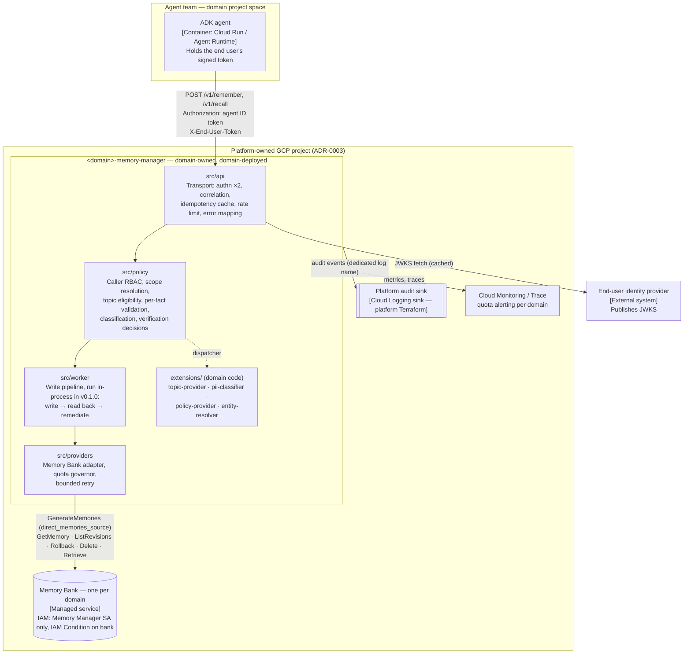

# Design — Memory Manager v0.1.0: a governed write path for agent memory

> Stage 2. Requires an approved `intent.md` (**VERIFIED** — `status: approved`, Srinivasa reddy,
> 2026-10-21). Approval at **Gate B** is required before the implementation plan.

## Method

Produced on 2026-10-21 on branch `design/001-memory-manager` at `c6258a5`. Read in full:

| Source | What it established |
|---|---|
| `design/001-memory-manager/intent.md` | Scope 1–11, non-goals, AC1–AC18, Q2–Q11 |
| `patterns/memory-manager/pattern.yaml`, `config/config.schema.json`, `config/example.domain.yaml` | Current manifest and configuration surface; status `proposed`; no contract |
| `patterns/memory-manager/{contracts,src,extensions,tests,conformance}/README.md`, `docs/*.md`, `infrastructure/terraform/*/README.md`, `examples/Dockerfile` | All are empty placeholders; no implementation exists |
| `docs/decisions/ADR-0001`, `ADR-0002`, `ADR-0003` | Published-pattern model; Python 3.12 + FastAPI; one platform project, one bank per domain |
| `standards/architecture.md`, `api-design.md`, `configuration.md`, `security.md`, `observability.md`, `pattern-contract.md` | Layering, contract rules, extension rules, C-01…C-19, telemetry, enforcement limits |
| Prior art `../geap-memory` at `4e989c3` (2026-10-05): `docs/vertex-memory-bank.md`, `docs/memory-bank-assumption-validation.md`, `apps/control-plane-api/app/control_plane_api/integrations/vertex_memory_store.py` | SDK surface, scope model, consistency, quota behaviour, why generation was turned off |
| `git tag -l` | Empty — no version of this pattern has been released |

Design decisions on Q2, Q5, Q6, Q8 and Q10 were put to the requester (project owner and platform
lead) in this session on 2026-10-21. Their answers are recorded below as **chosen**. Where the intent
names another owner (platform architect for Q2; security reviewer for Q5 and Q6), that owner's
confirmation is still required — at Gate B for the architect, Gate C for the security reviewer.

**Not done:** no call was made to a live Memory Bank. Every statement about provider behaviour that
is not traced to the prior art is an `ASSUMPTION`, and the ones this design depends on are listed in
[Live verification required before Gate C](#live-verification-required-before-gate-c).

## Summary

**PROPOSED.** A single Cloud Run service per domain exposes two tool operations, `remember` and
`recall`, under `/v1`. Each request is authenticated twice: the agent by its Google-signed ID token
(C-01), and the end user by a forwarded, signed end-user token that the service verifies itself. The
memory scope is derived only from that verified subject, via the `entity-resolver` extension, which
now fails closed. `remember` runs **synchronously**: each submitted fact is checked against the
agent's eligible topics (from the new `topic-provider` extension), its field schema, an inference
rule and the `pii-classifier`. The approved facts go in one `GenerateMemories` call with
`direct_memories_source`. When that long-running operation finishes, every memory it created or
updated is read back by name and classified again. A memory that consolidation turned into
prohibited content is **rolled back** to its previous revision if that revision is clean, and
**deleted** otherwise. `recall` returns only memories on topics the agent is approved for, and runs
each one through the same classifier before returning it, which closes the window between
consolidation and remediation. No queue or worker exists in v0.1.0. A per-domain token bucket and
bounded in-request retry protect the shared project quota.

## Decisions taken in this session

| ID | Question | Decision | Label |
|---|---|---|---|
| D1 | Q8 — sync or async in v0.1.0 | **Synchronous.** No Pub/Sub, no worker deployment, no `202`. Rate limiting, bounded retry with backoff and idempotency are in; dead-lettering is not applicable (there is no queue). Async moves to v0.2.0 alongside extraction. | PROPOSED — chosen by requester |
| D2 | Q2 — source of user identity | **Forwarded end-user token**, verified against a domain-configured issuer and JWKS. Subject → `entity-resolver` → scope. Failure denies. | PROPOSED — chosen by requester; platform architect to confirm |
| D3 | Q5, Q6 — consolidation rewrites into prohibited content | **Revision rollback** if the prior revision passes classification, otherwise **delete**. `recall` also re-classifies before returning. | PROPOSED — chosen by requester; security reviewer to confirm at Gate C |
| D4 | Q10 — what `recall` returns | **Approved topics only** — approved for the calling agent, enabled and eligible. | PROPOSED — chosen by requester |
| D5 | Q7 — verification cannot complete | Bounded in-request retry; then outcome `written_unverified`, an audit event, a metric and an alert. Never reported as verified. The recall-time check (D3) is the backstop. | PROPOSED — designer's recommendation; platform architect to decide |
| D6 | Q4 — `GenerateMemories` vs the prior art's direct `create` | Proceed with `GenerateMemories` as the intent scopes it. Consolidation is also what makes duplicate delivery harmless across instances (see [Idempotency](#idempotency)). Proposed as ADR. | PROPOSED — platform architect to decide |
| D7 | Q3 — "unsupported inference" | Each fact declares a `basis` (`stated` or `inferred`). A topic accepts `inferred` only if its configuration sets `allowInferred: true`; the default is `false`. The classifier may also return `unsupported_inference`. This makes AC7 testable; the domain-level definition stays with its owners. | PROPOSED — Q3 remains OPEN for platform lead + first domain |

## Architecture

### Container view

**PROPOSED** — C4 container level, v0.1.0.



Dependencies point downward only (`standards/architecture.md`). `src/worker/` hosts the write
pipeline even though v0.1.0 runs it inside the request. That keeps v0.2.0's move to an asynchronous
queue an additive change: the API layer starts enqueuing, and the worker code stays the same.

### `remember` — sequence, including failure paths

**PROPOSED.**

```mermaid
sequenceDiagram
    autonumber
    participant A as Agent
    participant API as api
    participant POL as policy (+ extensions)
    participant W as worker pipeline
    participant P as provider adapter
    participant MB as Memory Bank

    A->>API: POST /v1/remember (ID token, end-user token, Idempotency-Key, facts[])
    API->>API: verify agent ID token → registered caller (else 401 / 403)
    API->>API: verify end-user token (issuer, JWKS, aud, exp) (else 401)
    API->>API: Idempotency-Key present? replay cached result if seen (else 400)
    API->>API: per-caller rate limit (else 429 + Retry-After)
    API->>POL: authorize(caller, "write")
    POL-->>API: deny → 403 PERMISSION_DENIED
    API->>POL: resolve scope(subject) via entity-resolver
    POL-->>API: error / no mapping → 403 SCOPE_UNRESOLVED
    API->>POL: load topics(caller) via topic-provider
    POL-->>API: error / unconfigured → 503 POLICY_UNAVAILABLE, nothing written
    loop each fact
        POL->>POL: topic approved ∧ enabled ∧ eligible? field known? type valid? basis permitted?
        POL->>POL: pii-classifier(topic, field, value) — error ⇒ reject
    end
    alt no fact accepted
        API-->>A: 200 outcome=noop, per-fact reason codes; no provider call
    else ≥1 fact accepted
        API->>W: write(scope, accepted facts)
        W->>P: generate(scope, facts)
        P->>P: domain quota token — none ⇒ 503 DOMAIN_BUDGET_EXHAUSTED
        P->>MB: GenerateMemories(direct_memories_source)
        MB-->>P: 429 / 5xx ⇒ bounded retry, then 503 PROVIDER_UNAVAILABLE
        MB-->>P: LRO not done by deadline ⇒ 503 PROVIDER_OUTCOME_UNKNOWN
        MB-->>P: done: generated_memories[{name, action}]
        loop each CREATED / UPDATED memory
            W->>P: get(name)
            W->>POL: re-classify parsed fact (same classifier instance)
            alt prohibited or unparseable
                W->>P: list revisions → previous revision clean? rollback : delete
                W->>W: audit memory_rollback | memory_deletion
            end
        end
        alt any read-back failed after bounded retry
            API-->>A: 200 outcome=written_unverified (+ audit verification_incomplete)
        else
            API-->>A: 200 outcome=written, verification=verified | remediated
        end
    end
```

## Interfaces and contracts

The OpenAPI specification is written to `patterns/memory-manager/contracts/openapi.yaml` as the first
implementation task, before any handler, per `standards/api-design.md` ("contract first"). This
section fixes its semantics; the spec will be the normative shape.

| Operation | Method | Path | Breaking? |
|---|---|---|---|
| `remember` | `POST` | `/v1/remember` | No — new. No prior contract exists (**VERIFIED**: `contracts/` is empty, no git tags) |
| `recall` | `POST` | `/v1/recall` | No — new |
| liveness | `GET` | `/healthz` | No — new; unauthenticated, reveals nothing |
| readiness | `GET` | `/readyz` | No — new; configuration valid and provider reachable |

`pattern.yaml` `interfaces[openapi].status` moves from `planned` to `active` with the spec path once
the spec exists. MCP stays `planned`.

### Request headers (both operations)

| Header | Required | Meaning |
|---|---|---|
| `Authorization: Bearer <ID token>` | yes | The agent's Google-signed ID token, audience = the service URL. Maps to exactly one registered caller (C-01). |
| `X-End-User-Token` | yes | The end user's signed token. Verified against the configured issuer and JWKS, its audience and its expiry. Never logged. |
| `Idempotency-Key` | yes on `remember` | 1–128 characters, opaque. See [Idempotency](#idempotency). |
| `X-Correlation-ID` | no | Propagated, or generated; always returned. |

Any `user_id`, `scope`, `role`, `domain` or `bank` field in the body is **rejected as an unknown
field** (`400 REQUEST_INVALID`, `additionalProperties: false`). That proves AC3 in two ways: the
fields cannot be sent, and a test that sends them anyway confirms only the token-derived scope is
read or written.

### `remember`

Request body:

```json
{
  "facts": [
    { "topic": "preferred_brands", "field": "brand", "value": "<value>", "basis": "stated" }
  ]
}
```

`facts`: 1–20 items (upper bound PROPOSED). `basis` ∈ `stated` | `inferred`. `value` type follows the
topic's field definition.

Response `200`:

```json
{
  "outcome": "written | written_unverified | noop",
  "verification": { "status": "verified | remediated | incomplete | not_applicable", "remediated": 0 },
  "facts": [ { "index": 0, "topic": "preferred_brands", "decision": "accepted | rejected", "reason_code": "..." } ],
  "correlation_id": "..."
}
```

The response **never echoes a value**. `topic` is a configured name, not content.

### `recall`

Request body: `{ "topics": ["preferred_brands"], "page_size": 50, "page_token": "..." }`. `topics`
is optional and can only **narrow** the agent's approved set (D4). A topic outside that set causes a
`403 TOPIC_NOT_APPROVED` for the request. Silently dropping it would hide misconfiguration.

Response `200`:
`{ "memories": [ { "memory_id": "...", "topic": "...", "field": "...", "value": ..., "update_time": "..." } ], "next_page_token": "...", "withheld": 0, "correlation_id": "..." }`

Recall checks each memory before returning it: the fact must parse, its topic must be approved for
the agent, and the classifier must allow it. A memory that fails is withheld and counted in
`withheld`, which reveals no content, and an audit event `recall_withheld` is emitted. If it failed
on classification, remediation (D3) is attempted best-effort; a failed remediation does not fail the
recall. Withholding is fail-closed: a classifier error withholds.

### Status codes and error catalogue

Every error returns `{ "error": { "code", "message", "correlation_id" } }`, with no payload content.

| Status | Code | When |
|---|---|---|
| 400 | `REQUEST_INVALID` | Schema violation, including any scope/user/role field in the body |
| 400 | `IDEMPOTENCY_KEY_REQUIRED` | `remember` without the header |
| 401 | `UNAUTHENTICATED` | Missing or invalid agent ID token |
| 401 | `END_USER_TOKEN_INVALID` | Missing, expired, wrong issuer/audience, bad signature |
| 403 | `CALLER_NOT_REGISTERED` | Valid token, no registered caller |
| 403 | `PERMISSION_DENIED` | Role lacks `write` / `read`, or `policy-provider` denies or errors |
| 403 | `SCOPE_UNRESOLVED` | `entity-resolver` errors or returns no mapping |
| 403 | `TOPIC_NOT_APPROVED` | `recall` names a topic outside the approved set |
| 422 | `IDEMPOTENCY_KEY_REUSED` | Same key, different payload, detected on this instance |
| 429 | `RATE_LIMITED` | Caller exceeded **its own** limit; `Retry-After` set |
| 503 | `POLICY_UNAVAILABLE` | `topic-provider` errors or is unconfigured — nothing written (AC8) |
| 503 | `DOMAIN_BUDGET_EXHAUSTED` | The domain's quota budget is spent; `Retry-After` set |
| 503 | `PROVIDER_UNAVAILABLE` | Provider 429 / 5xx after bounded retry; `Retry-After` set |
| 503 | `PROVIDER_OUTCOME_UNKNOWN` | Write submitted, outcome not known by deadline; retry with the same key |

Per-fact `reason_code` values (inside a `200`): `ACCEPTED`, `TOPIC_UNKNOWN`, `TOPIC_DISABLED`,
`TOPIC_NOT_APPROVED`, `TOPIC_SENSITIVE`, `TOPIC_RESTRICTED`, `FIELD_UNKNOWN`, `VALUE_TYPE_INVALID`,
`VALUE_PROHIBITED`, `INFERENCE_NOT_PERMITTED`, `UNSUPPORTED_INFERENCE`, `CLASSIFIER_ERROR`.

**Deliberate deviation from `standards/api-design.md`, for Gate B:** the standard maps a provider
`429` to "parked + `202`". That rule is written for asynchronous writes. With D1 there is nowhere to
park the write, so a provider `429` becomes `503 PROVIDER_UNAVAILABLE` with `Retry-After`. It is
still never the caller's `429` and never the provider's raw text. The standard should say this
explicitly; that is reported here, not edited (CLAUDE.md rule 11).

## Data contracts

### Scope

The bank is per domain (ADR-0003), so the scope carries only the end-user key:
`{ "user_id": <entity-resolver output> }`. The value is an opaque identifier. The default resolver
passes the token's subject claim through. A domain that needs a different internal ID supplies its
own resolver. The bank resource name comes from deployment configuration, as an output of
platform-owned Terraform; no request field can select it (AC14).

### Stored fact

The `fact` string sent in `direct_memories_source` is a canonical, deterministic encoding:

```
[topic=preferred_brands][field=brand] <value>
```

Two reasons for this encoding:

1. **Consolidation operates on natural language.** The prior art's JSON facts were written with
   `create`, which never consolidates. A JSON blob passed through an LLM merge is likely to come back
   malformed. **ASSUMPTION**: a short bracketed prefix survives consolidation more reliably than
   JSON. This must be tested live.
2. **Fail closed on drift.** Read-back and recall parse the prefix. A memory whose prefix is missing,
   duplicated, or names a topic that is not eligible is treated as **prohibited** and remediated. It
   is never returned.

Provider-side memory metadata, if the `agentplatform` surface supports it on direct memories, is
preferable to an in-text prefix. **OPEN** — resolved by live verification. If supported, the prefix
remains as a cross-check.

### Retention (Q11)

Each topic may declare `retentionDays`, bounded by a platform maximum held in the schema, not in
domain configuration. Enforcement uses the provider's per-memory expiry, set on write.
**ASSUMPTION**: `GenerateMemories` accepts a TTL for direct memories. The bound values remain
**OPEN** pending Legal; the prior art's 1095 / 730 days are placeholders (**VERIFIED**,
`memory-bank-assumption-validation.md`). If no TTL is available, C-09 is a declared Gap at Gate C.

### Idempotency

D1 removes the queue, and the intent introduces no state store. This is the weakest part of the
design, so it is set out in full here:

- **Per-instance**: an in-memory LRU cache keyed by `(caller, Idempotency-Key)` → (payload hash,
  response), with a 10-minute window (PROPOSED). A replay on the same instance returns the original
  response; a different payload returns `422`.
- **Across instances**: there is no shared record. A duplicate that lands on a different instance
  submits the same facts again, and **provider consolidation dedups an identical fact into the
  existing memory without creating a new one** (ASSUMPTION — the central claim of D6, verified live).
  The effect is single, and the cost is one extra provider write.
- **Gap against the standard**: `standards/api-design.md` requires same-key/different-payload → `422`
  for all deliveries. Across instances, v0.1.0 cannot guarantee that. **OPEN**, for the platform
  architect at Gate B: (a) accept, and record an exception at Gate C with v0.2.0 as the expiry; or
  (b) add a shared store (Firestore or Memorystore). Option (b) adds a managed service the intent
  does not include, and so means returning to Stage 1. The reference deployment's
  `max_instances` cap narrows the window but does not close it.

## Configuration and extension points

### Configuration changes (`config/config.schema.json`)

None of these are breaking: no version has been released, and the schema validates nothing yet
(**VERIFIED**: no tags; `src/` empty).

| Change | Reason |
|---|---|
| **Add** `topics`: `version` (string, required), `definitions[]` with `id`, `classification` ∈ manifest vocabulary (`public` `internal` `sensitive` `restricted`), `extraction` ∈ `allowed` `blocked`, `enabled`, `allowInferred` (default `false`), `retentionDays`, `fields{name: {type, maxLength/enum}}` | Scope 4, 5, 10 |
| **Add** `rbac.roles[].topics[]` | Per-agent approval (Scope 4, AC4 "not approved") |
| **Add** `callers[]`: `id`, `principal` (service account identity), `role` | Exactly-one registered caller (C-01) |
| **Add** `endUserIdentity`: `issuer`, `jwksUri`, `audiences[]`, `subjectClaim` (default `sub`) | D2 |
| **Add** `limits`: `perCallerRequestsPerMinute`, `domainProviderRequestsPerMinute` (bounded by schema maxima) | C-17, C-19 |
| **Narrow** `rbac.roles[].permissions` enum to `read`, `write` | `correct`/`forget`/`list` are non-goals. Re-adding them later is additive |
| **Remove** `privacy` | Superseded by topic classification. Two vocabularies for one decision would drift apart |

Eligibility is computed, not configured: a topic is eligible **iff** `enabled` ∧ `classification` ∈
{`public`, `internal`} ∧ approved for the caller's role. `sensitive` and `restricted` are never
eligible in v0.1.0, whatever else is set. No key exists that can make them eligible. `extraction` is
validated and stored but **not read** by any v0.1.0 code path (intent Scope "Reference topic
configuration").

The reference topic set from the intent (`preferred_brands`, `preferred_cuisines`,
`medical_conditions`, `prescription_details`) ships in `config/example.domain.yaml`, never in `src/`.

### Extension points (`pattern.yaml` `spec.extensionPoints`)

| Extension point | Interface | Required | Default | Failure mode |
|---|---|---|---|---|
| `topic-provider` **(new)** | `extensions/topic_provider.py` — `topics_for(caller_id) -> TopicSet` | no | `yaml-config` — reads `topics` from the validated configuration | **deny** — request `503 POLICY_UNAVAILABLE`, nothing written |
| `pii-classifier` | `extensions/pii_classifier.py` — `classify(topic, field, value) -> allowed \| prohibited \| unsupported_inference` | yes | `deny-all` | **deny** — fact rejected `CLASSIFIER_ERROR`; on read-back, memory remediated; on recall, withheld |
| `policy-provider` | `extensions/policy_provider.py` — `refine(caller, operation, decision) -> decision` | no **(changed from yes)** | `passthrough` **(changed from deny-all)** — returns the platform RBAC decision unchanged | **deny** |
| `entity-resolver` | `extensions/entity_resolver.py` — `resolve(subject) -> user_id` | no | `subject-passthrough` (was `noop`) | **deny (changed from skip)** — `403 SCOPE_UNRESOLVED` |
| `fact-curator` | — | — | — | **Removed in v0.1.0.** Provider consolidation is the merge policy (D6). If Q4 rejects consolidation, this comes back. |

Two of these changes concern security posture and are called out for Gate B and Gate C:

- **`entity-resolver` `skip` → `deny`.** Ownership resolution now runs through it, and skipping it
  would write to an unresolved scope. The intent's Constraints section anticipated this change.
- **`policy-provider` `deny-all` → `passthrough`, not required.** The platform RBAC decision (from
  `rbac` + `callers`) already fails closed: an unknown caller, an unknown role or a missing
  permission all deny. With deny-all as the default for a *refinement* hook, an otherwise-configured
  domain would store nothing until it wrote code for a no-op. The extension can still only **further
  deny**: an "allow" from it cannot overturn a platform denial (`standards/configuration.md`), and a
  unit test asserts that. **Reviewer attention requested** — this relaxes a default, even though it
  does not relax a control.

The classifier used before the write and the one used after it are the **same instance**, loaded
once at startup. That turns the intent's third assumption into a property of the design.

## Platform vs. domain

| Platform mechanism (`src/`) | Domain policy (configuration / extensions) |
|---|---|
| Verifying both tokens; the obligation to map exactly one caller | The callers, their roles, the end-user issuer |
| The order of checks: authn → authz → scope → topics → per-fact → classify → write → verify | Which topics exist, their fields, classification, `allowInferred`, retention |
| The eligibility rule: `sensitive` and `restricted` never eligible | Which topics each role is approved for |
| The obligation to classify before write, after write, and before recall | The classifier itself (`pii-classifier`) |
| Rollback-or-delete remediation and its audit | — |
| Quota governor, bounded retry, idempotency cache | The per-caller limit and domain budget, within schema maxima |
| The fact encoding and its fail-closed parse | How a subject maps to an internal user ID (`entity-resolver`) |

**Non-overridable by domain configuration** (`spec.security.nonOverridableControls`, unchanged):
C-01, C-02, C-05, C-06, C-07, C-08, C-11, C-16. In this design that means: no configuration key
exists to skip either token check, to make a sensitive or restricted topic eligible, to skip
post-write verification or recall-time classification, to suppress an audit event, to log a value,
or to select a bank.

Per `standards/pattern-contract.md`, these controls are **verified for the reference implementation
and contractually required of adopters**. Only the bank IAM binding, the audit sink and quota
alerting are enforced for every consumer, because they live in platform-owned Terraform.

## Alternatives considered

| Option | Pros | Cons | Why not chosen |
|---|---|---|---|
| **Do nothing** — agents call Memory Bank directly | No new service | No authorization, no topic governance, no classification; violates C-11 ("never to an agent") | Rejected — it is the problem the intent exists to solve |
| **Direct `create` (prior art)** instead of `GenerateMemories` | No consolidation, so no rewrite risk and no post-write verification; cheaper per write; proven live in the prior art | No dedup, so cross-instance idempotency needs a shared store; duplicates accumulate; departs from intent Scope 6 | Not chosen — the intent scopes `GenerateMemories`. Recorded for the Q4 ADR as the fallback if live verification shows consolidation is unsafe |
| **Asynchronous queue + worker (the original diagram)** | `202` hides provider latency; absorbs provider 429s by parking; true dead-lettering | Adds Pub/Sub, a DLQ, a status endpoint and worker deployment; the response can't say "verified" | Not chosen for v0.1.0 (D1). The worker layer is kept so it can be added in v0.2.0 |
| **Agent asserts the user** (`user_ref` in body → resolver) | Simplest for agents | The agent decides whose memory it writes — defeats AC3 | Rejected (D2) |
| **Session-service lookup** for user identity | No end-user token handling in the service | Another managed-service dependency and IAM path; couples the pattern to one agent runtime's session store | Not chosen (D2) |
| **Delete-only remediation** | No dependency on the revisions API | Deletes previously valid content merged into the rewritten memory (Q6) | Not chosen (D3). It is the fallback when no clean prior revision exists, and if live verification shows rollback is unusable |
| **Recall without re-classification** | One fewer classifier call per memory | Prohibited content is recallable between consolidation and remediation (Q5), and indefinitely if verification was incomplete | Rejected (D3) |
| **Shared idempotency store** (Firestore / Memorystore) | Meets the idempotency standard fully across instances | A new managed service outside the intent | Deferred — OPEN at Gate B; it would mean returning to Stage 1 |

## Failure handling and operations

| Failure | Behaviour | Caller sees |
|---|---|---|
| Agent token missing or invalid | Deny | `401 UNAUTHENTICATED` |
| End-user token invalid, or JWKS unreachable and cache expired | Deny. JWKS cached with a bounded TTL; no fallback to unsigned tokens | `401 END_USER_TOKEN_INVALID` |
| Caller unregistered / no permission / `policy-provider` raises | Deny; `extension_errors` if it raised | `403` |
| `entity-resolver` raises or returns nothing | Deny | `403 SCOPE_UNRESOLVED` |
| `topic-provider` raises or is unconfigured | Deny the whole request; nothing written | `503 POLICY_UNAVAILABLE` |
| `pii-classifier` raises for one fact | That fact rejected; others proceed | `200`, fact `CLASSIFIER_ERROR` |
| No eligible facts | No provider call | `200 noop` (AC10) |
| Domain budget exhausted | No provider call | `503 DOMAIN_BUDGET_EXHAUSTED` + `Retry-After` |
| Provider `429` / `5xx` on write | Up to 2 retries, exponential backoff with full jitter, honouring provider `Retry-After`, within a 10 s write deadline. Each retry consumes a budget token, so retries cannot amplify load (C-17) | `503 PROVIDER_UNAVAILABLE` + `Retry-After` |
| LRO not done by deadline | Not cancelled; outcome unknown; audit `memory_write` with decision `unknown` | `503 PROVIDER_OUTCOME_UNKNOWN`. A retry with the same key relies on consolidation dedup |
| Read-back `get` fails or memory not yet visible | Up to 3 attempts, 250 ms → 1 s, within a 5 s verification deadline | `200 written_unverified` + audit `verification_incomplete` + alert (D5) |
| Rewritten memory prohibited | List revisions → previous clean? rollback : delete. Audit each | `200 written, verification=remediated` |
| Rollback or delete fails | Audit `remediation_failed`, severity `ERROR`, alert. Recall withholds the memory regardless | `200 written_unverified` |
| Provider unavailable on recall | Bounded retry as for writes | `503 PROVIDER_UNAVAILABLE` |

**End-to-end deadline.** `remember` waits for an LLM-backed consolidation, so its latency is seconds,
not milliseconds. The deadline is 30 s (PROPOSED) and the Cloud Run request timeout is set above it.
Agents should call `remember` off the user's critical path (for example from an ADK after-agent
callback). Real latency is **OPEN** until measured live.

**Quota and cross-domain contention (ADR-0003).** The shared quota is the main operational risk.
Cost per call, in provider requests:

| Call | Provider requests |
|---|---|
| `remember`, no-op | 0 |
| `remember`, *k* memories touched | 1 `GenerateMemories` + LRO polls + *k* `get` (+ 2 per remediation: list revisions, rollback/delete) |
| `recall` | 1 `Retrieve` per page (+ remediation for withheld memories) |

The governor is a token bucket per domain, refilled at `domainProviderRequestsPerMinute`, and every
provider request takes a token. **Limitation, stated plainly:** both the governor and the per-caller
limiter are **per instance**. The effective domain ceiling is the configured budget × the live
instance count. The reference Terraform therefore sets `max_instances` and divides the budget by it.
A precise global limiter needs a shared store and falls under the same OPEN question as idempotency.
`quota_consumed{domain}` and `provider_throttled` let the platform triage a contention incident
across domains; quota alerting is platform-owned (C-18, C-19).

**Degraded operation.** If Memory Bank is down, writes and recalls fail with `503` and nothing is
buffered. Agents keep whatever they already hold in session state, as the prior art does today
(**VERIFIED**, "Provider failure policy" in `memory-bank-assumption-validation.md`).

**Recovery and replay.** No queue exists, so there is nothing to replay. The caller's retry, with the
same `Idempotency-Key`, is the recovery path. Remediation failures are retried at the next recall of
that scope, which withholds the memory and attempts remediation again.

**Dead-lettering:** not applicable in v0.1.0 — there is no queue (D1). Gate C records C-17's
dead-letter clause as not applicable for that reason.

## Backward compatibility and migration

Nothing breaks. **VERIFIED** by: `git tag -l` returns nothing; `spec.upgrade.from` is `[]`;
`contracts/`, `src/`, `extensions/` contain only README placeholders; pattern status is `proposed`.
No agent or domain can depend on any current surface.

Changes to the manifest this design requires (made during implementation, not here):

| Field | Change |
|---|---|
| `metadata.description` | Drop "async write processing"; describe the sync governed write path |
| `spec.interfaces[openapi]` | `status: active`, `spec: patterns/memory-manager/contracts/openapi.yaml` |
| `spec.extensionPoints` | As in the table above: add `topic-provider`; change `entity-resolver` and `policy-provider`; remove `fact-curator` |
| `spec.secrets` | **Remove** `MEMORY_BANK_CREDENTIALS`. The service uses Workload Identity, and a credentials secret contradicts the security baseline ("never a downloaded key file") |
| `spec.cloudPermissions` | One component, `api`: `roles/logging.logWriter`, `roles/cloudtrace.agent`, `roles/monitoring.metricWriter`. Remove the Pub/Sub and Secret Manager roles, and the `worker` component. The Memory Bank role is granted by **platform** Terraform and is named there, not here. The exact role is OPEN until Gate C |
| `spec.observability.requiredMetrics` | Remove `queue_depth`, `queue_age_oldest`, `dead_letter_depth`. Add `facts_evaluated`, `verification_outcomes`, `remediations`, `recall_withheld`, `quota_budget_exhausted` |
| `spec.observability.requiredAuditEvents` | Add `memory_rollback`, `verification_incomplete`, `remediation_failed`, `recall_withheld` |
| `spec.observability.prohibitedLogFields` | Add `end_user_token` |
| `spec.compatibility.memoryBankSdk` | Pin the `agentplatform` 2.x range verified live |

Migrating to v0.2.0 (async, extraction) is expected to add to the contract (`202` and an operation
status resource), not break it. That is a forecast, not a commitment.

## Observability

**Logs** — the required fields from `standards/observability.md`. `operation` ∈ `remember`, `recall`,
`verify`, `remediate`. Logs carry the topic **name**, the per-fact decision, the reason code and
counts. Never a value, the fact string, the subject or either token.

**Traces** — spans: `remember` / `recall`; `policy.authorize`; `policy.resolve_scope`;
`policy.evaluate_fact` (attributes: topic, decision, reason_code); `provider.generate_memories`;
`provider.get_memory`; `verify`; `remediate` (attribute: action). Span attributes follow the
prohibited-field list.

**Metrics** — the required set, minus the queue metrics, plus:

| Metric | Type | Labels |
|---|---|---|
| `facts_evaluated` | counter | decision, reason_code |
| `verification_outcomes` | counter | status |
| `remediations` | counter | action (`rollback`, `delete`, `failed`) |
| `recall_withheld` | counter | reason_code |
| `quota_budget_exhausted` | counter | domain |

Label values are drawn only from closed enumerations. A topic name is configuration, but it is not
used as a metric label, which keeps cardinality bounded.

**Audit events** to the platform sink, each with correlation ID, caller, domain, operation, memory
*name*, scope *identifier*, decision and reason, and never the value:

| Event | Emitted on |
|---|---|
| `memory_write` | Every provider write, one per touched memory; decision `written` or `unknown` |
| `policy_denial` | Every request-level deny, and one per rejected fact (AC16) |
| `memory_rollback` / `memory_deletion` | Every remediation (AC11) |
| `verification_incomplete` / `remediation_failed` | D5 |
| `recall_withheld` | Recall-time withholding |
| `configuration_change` | Startup, with the topic configuration `version` |

`role_grant`, `role_revocation` and `exception_invoked` stay declared. No v0.1.0 code path emits them,
because roles change through configuration deployment, which emits `configuration_change`.

**Prohibited-field test (AC15).** Every test fixture value contains a unique sentinel. A test captures
all logs, spans, audit events and error bodies across the full AC suite and fails if any sentinel
appears. Removing the redaction must make the test fail.

## Acceptance-criteria traceability

| AC | Addressed by |
|---|---|
| 1 | Agent ID-token verification → `401`; conformance test |
| 2 | RBAC `write` permission → `403 PERMISSION_DENIED` |
| 3 | Scope from verified end-user token only; body scope fields rejected; test reads both scopes |
| 4 | Eligibility rule + per-fact reason codes; one test per case on the reference config |
| 5 | Field schema per topic → `FIELD_UNKNOWN` / `VALUE_TYPE_INVALID` |
| 6 | `pii-classifier` → `VALUE_PROHIBITED`; reference test classifier flags marker values |
| 7 | `basis` + `allowInferred` → `INFERENCE_NOT_PERMITTED`; classifier `UNSUPPORTED_INFERENCE` (D7; Q3 still OPEN) |
| 8 | `topic-provider` error → `503`, nothing written; classifier error → fact rejected |
| 9 | Provider adapter sends only `direct_memories_source`; fake-client test on call shape; separate live test |
| 10 | `200 noop`, fake provider records zero calls |
| 11 | Fake provider rewrites on consolidation → rollback / delete + audit |
| 12 | Fake provider fails `get` → `written_unverified`, never `verified` (D5) |
| 13 | **N = 10 s** (PROPOSED): conformance polls `recall` every 1 s up to N. N is final only after the live test |
| 14 | Bank from deployment config; no request field selects it; IAM Condition on the bank (live) |
| 15 | Sentinel test across logs, traces, audit, errors |
| 16 | Audit event table above; test per event type |
| 17 | Second example config with a different topic set, served by an unchanged image |
| 18 | Conformance suite runs the built image with the fake provider, which is permitted only when `environment: local` (refusal tested), and has a separately labelled live profile |

## Live verification required before Gate C

The intent already requires the first item before Gate C. The design rests on all of them. Each is
run against a real bank in the platform project, and recorded with its output:

| # | Assumption | If false |
|---|---|---|
| L1 | `GenerateMemories` + `direct_memories_source` stores the given facts without extraction and still consolidates | Q4 fallback: direct `create`, no verification, shared idempotency store — re-enter design |
| L2 | The LRO result lists affected memories by name with an action (created/updated/deleted) | Read-back falls back to `Retrieve` on the scope; quota cost rises |
| L3 | `get` by name immediately after LRO completion reflects the consolidated content | Verification retry deadline lengthens; `written_unverified` becomes more frequent |
| L4 | Revisions are listable and `rollback` works on a memory created by `GenerateMemories` | D3 degrades to delete-only |
| L5 | An identical fact submitted twice consolidates into one memory | Cross-instance idempotency has no backstop — the OPEN becomes a blocker |
| L6 | The bracketed fact prefix survives consolidation | Consolidated memories get remediated as unparseable; use provider metadata if available, else re-enter design |
| L7 | Per-memory TTL is accepted on direct memories | C-09 becomes a declared Gap |
| L8 | Scope-only `Retrieve` returns every memory in the scope, with pagination | Recall must cap and say so; possible contract change before release |
| L9 | Read-after-write bound for AC13, at p99 | N is revised before release |
| L10 | An IAM Condition can restrict the Memory Manager SA to its own domain's bank | C-16 rests on SA separation alone — security reviewer decides |

## Assumptions and open questions

| ID | Item | Label | Resolution needed |
|---|---|---|---|
| Q2 | End-user identity source | PROPOSED (D2) | Platform architect confirms at Gate B |
| Q3 | Definition of "unsupported inference" | OPEN | Platform lead + first domain. D7 makes AC7 testable meanwhile |
| Q4 | `GenerateMemories` vs direct `create` | OPEN | Platform architect; ADR. Depends on L1, L5 |
| Q5 | Recall-time re-classification | PROPOSED (D3) | Security reviewer at Gate C |
| Q6 | Rollback, else delete | PROPOSED (D3) | Security reviewer at Gate C; depends on L4 |
| Q7 | Verification incomplete → `written_unverified` | PROPOSED (D5) | Platform architect at Gate B |
| Q8 | Synchronous, no queue | PROPOSED (D1) | Approved by requester; recorded in ADR |
| Q9 | N = 10 s | PROPOSED | Live test L9 |
| Q10 | Recall returns approved topics only | PROPOSED (D4) | Approved by requester |
| Q11 | Retention bounds | OPEN | Legal + platform lead; schema carries the key, values pending |
| O1 | Cross-instance idempotency without a shared store | OPEN | Platform architect at Gate B: accept with Gate C exception (expiry v0.2.0), or add a store and return to Stage 1 |
| O2 | Per-instance rate limiting and budget | OPEN | Same decision as O1 |
| O3 | Exact Memory Bank IAM role for the SA | OPEN | Gate C, from platform Terraform |
| O4 | `remember` latency budget | OPEN | Measured live; 30 s deadline is PROPOSED |
| O5 | `standards/api-design.md` lacks a synchronous-write provider-429 rule | OPEN | Platform lead — a separate light-track change to the standard |
| O6 | `policy-provider` default relaxed to `passthrough` | PROPOSED | Security reviewer — see Configuration |
| A1 | All of L1–L10 | ASSUMPTION | Live verification before Gate C |
| A2 | The supplied diagram's label "one bank per agent" | VERIFIED as divergent; ADR-0003 stands | Diagram author confirmation, unchanged from the intent |

## Proposed ADRs

Numbers are tentative. `design-record-decision` writes them only after Gate B approval.

| ID | Decision |
|---|---|
| ADR-0004 | Memory writes use `GenerateMemories` with `direct_memories_source`, followed by post-write verification and rollback-else-delete remediation, with recall-time re-classification as the backstop (Q4, Q5, Q6, D3, D6) |
| ADR-0005 | End-user identity comes from a forwarded, service-verified end-user token. The scope is derived only from it, through an `entity-resolver` that fails closed (Q2, D2) |
| ADR-0006 | v0.1.0 writes are synchronous: no queue, per-instance limiters, provider `429` → `503`. Records the idempotency and rate-limit limits and their v0.2.0 exit (Q8, D1, O1, O2) |
| ADR-0007 | Topic eligibility is driven by a new `topic-provider` extension point over versioned YAML. `sensitive` and `restricted` are never eligible, and the `privacy` block is replaced (Scope 4, 10) |

## Approval

**Gate B.** Not approved. A platform architect sets `status: approved` with `approved_by` and
`approved_date` after reviewing the approach, D1–D7, and O1 in particular, which decides whether this
design stays within the approved intent.
