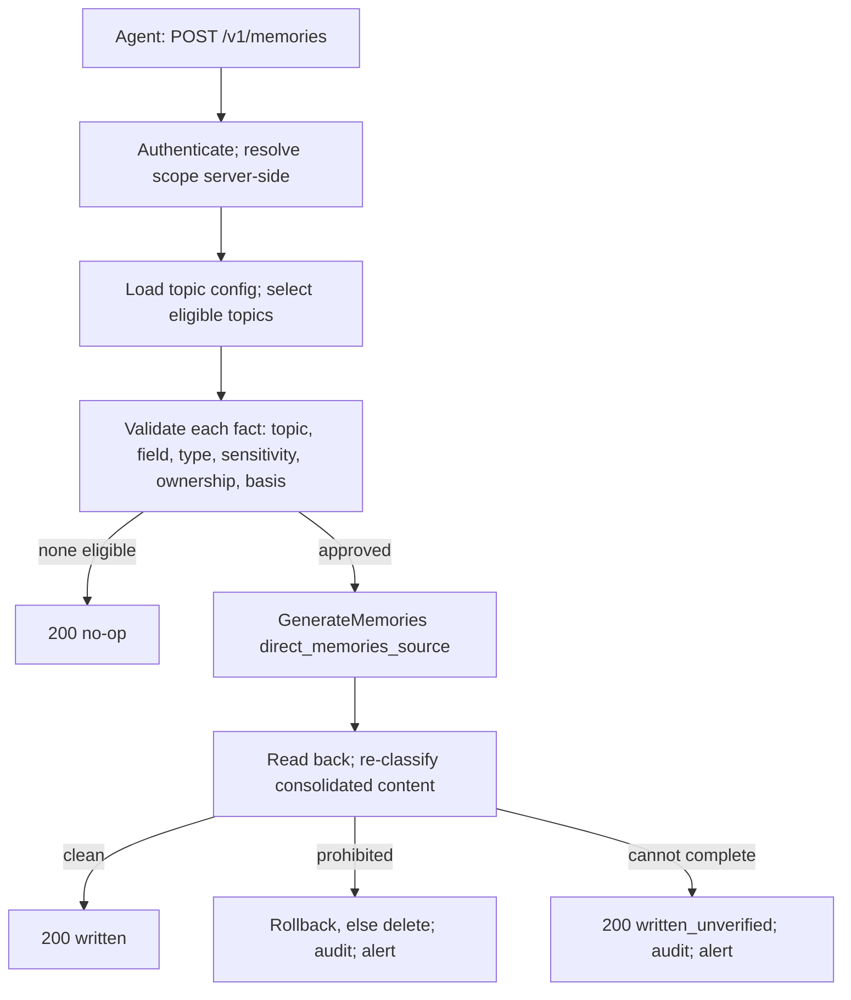

# Memory Manager v0.1.0 — design

Requires an approved `intent.md` (**VERIFIED** — approved 2026-10-21).

## Provider assumptions verified

Probed against a real Memory Bank on 2026-10-22 with
[`spike/probe_memory_bank.py`](spike/probe_memory_bank.py). Raw results:
[`spike/tier1-results.json`](spike/tier1-results.json).

| Assumption | Result |
|---|---|
| `GenerateMemories` + `direct_memories_source` stores facts verbatim, no extraction, and still consolidates | **PASS** — stored facts equalled the input; a conflicting second write returned `UPDATED` |
| The operation result names affected memories with an action | **PASS** |
| `get` immediately after the operation reflects consolidated content | **PASS** |
| Revisions are listable and `rollback` works; the prohibited revision is gone afterwards | **PASS** — 0 listable, 0 retrievable after rollback and after delete |
| An identical fact submitted twice consolidates into one memory | **PASS** — returned `UPDATED`, one memory in scope |
| The `[topic=…][field=…]` prefix survives consolidation | **PASS** |
| Bank-level TTL applies, survives consolidation, and the memory expires | **PASS** — a consolidation update **resets** the TTL |
| Scope-only retrieve returns everything, with pagination | **PASS** — 12 memories over 3 pages, 0 missing |
| Read-after-write latency | **PASS** — p99 0.16 s against a 10 s bound |
| Memory Bank supports a customer-managed key | **PARTLY RESOLVED, 2026-10-23** — the API surface accepts one: `CreateMemoryBankConfig.encryption_spec.kms_key_name`, verified by inspecting the installed SDK. Settable **only at bank creation**. That it works end to end is still **UNAVAILABLE** — Cloud KMS is not enabled, so nothing was created with one |

**The client moved under us (2026-10-23).** `vertexai.Client` is deprecated in the same pinned
release in favour of `agentplatform.Client`, and the memory operations move from
`agent_engines.memories` to `memory_banks.memories`. Every method name and keyword the adapter
uses was compared across the two clients and is identical, so this is a client swap, not a
redesign — no version bump, no contract change, and the `MemoryBank` Protocol is untouched.

**The resource is unchanged, and I first got this wrong.** `memory_banks` reads like a new
first-class resource, and a grep of the package found `memoryBanks/<id>` path patterns, so the
adapter, the Terraform IAM Condition and this table were changed to match. That was wrong: the
module still POSTs to `reasoningEngines`, and the `memoryBanks/` patterns belong to a helper that
*parses* either spelling. A bank remains one Agent Engine carrying a
`context_spec.memory_bank_config` — `reasoningEngines/<id>` — which is what the spike observed
live on 2026-10-22. All of it is reverted. Recorded because an IAM Condition was changed on the
strength of a grep, and the condition is the one platform-side control that cannot be bypassed.

**Correction to an earlier claim.** The Terraform module said the provider had no resource for the
engine. Checked against the pinned provider's own schema: google 7.45 *does* have
`google_vertex_ai_reasoning_engine` and its IAM resources, though they do not express the memory
bank configuration — so the bank is still created out of band, but the earlier wording overstated
the gap.

**Live verification of the implementation, 2026-10-23.** Everything above was probe code against
the SDK. `spike/verify_live.py` drives the *service* — endpoints, policy pipeline, adapter,
read-back verification — against a real bank (`geap-probe-tier1-main`, project `e2eml-222003`).
**19/19 checks passed:** write round trip 2.1 s, `ACCEPTED` with a memory id, read-back
verification clean, recall returning the fact with its topic and field prefix decoded and nothing
withheld, a sensitive topic refused before reaching the provider, a conflicting second write
consolidating into one memory rather than duplicating, and a second end user seeing an empty
scope. Memories written by the run were deleted afterwards.

Two observations from the run, neither a defect:

- `list` is **not** eventually consistent here — a written memory appeared in a scope listing
  0.6 s after the write, measured directly. The read-back path can rely on it.
- The pipeline denies when a domain's extension has the wrong method signature. The first run of
  the script had `decide` wrong and every fact came back `TOPIC_NOT_APPROVED`. That is the
  fail-closed rule working, observed by accident against a real provider.

**Two hard provider limits found:**

- **Max 5 facts per `GenerateMemories` request.** The contract caps `remember` at **5 facts**.
  Splitting into several requests would reintroduce the partial-failure semantics the synchronous
  design exists to avoid.
- **SDK 2.3.0 cannot page `memories.retrieve`** — its pager puts the page token where its own
  validation rejects it. **OPEN**: test whether another 2.x release fixes it before designing around
  it. Platform code must never call a private SDK method.

## Approach

Synchronous. No queue, no worker, no `202` — those move to v0.2.0 with extraction.

`recall` re-classifies before returning, as a backstop.

## Contract

| Operation | Method | Path | Notes |
|---|---|---|---|
| remember | POST | `/v1/memories` | **max 5 facts**; `Idempotency-Key` required; returns `200` with a per-fact result |
| recall | GET | `/v1/memories` | Approved, enabled, eligible topics only |

Per-fact reason codes: `ACCEPTED`, `TOPIC_UNKNOWN`, `TOPIC_DISABLED`, `TOPIC_NOT_APPROVED`,
`TOPIC_SENSITIVE`, `TOPIC_RESTRICTED`, `FIELD_UNKNOWN`, `VALUE_TYPE_INVALID`, `VALUE_PROHIBITED`,
`INFERENCE_NOT_PERMITTED`, `CLASSIFIER_ERROR`.

Request-level: `401` unauthenticated · `403` not permitted · `422` same key different payload ·
`429` caller's own rate limit · `503` dependency unavailable, retry with the same key.

A provider `429` becomes `503`, never the caller's `429` and never the provider's raw text.

## Configuration and extension points

Topics in versioned YAML: id, classification (`non-sensitive` / `sensitive` / `restricted`),
`enabled`, `allowInferred` (default **false**), value type.

**Retention is one period per domain**, set on the bank by platform Terraform. Per-topic retention is
not possible — TTL is a bank-level setting and each domain has one bank. Deferred to v0.2.0.

| Extension point | Required | Default | On failure |
|---|---|---|---|
| `pii-classifier` | yes | **deny-all** | deny |
| `policy-provider` | yes | **deny-all** | deny |
| `topic-provider` | no | YAML file | deny |
| `entity-resolver` | no | no-op | skip |

## Security

| Rule | How it's met | Test |
|---|---|---|
| S-1 | Forwarded end-user token verified against a domain-configured issuer and JWKS; dev header refused outside local | `test_auth.py` — 401, and startup refusal |
| S-2 | Unknown topic, unknown classification, classifier error all deny | `test_policy_deny_paths.py` |
| S-3 | Classify before write **and** re-classify after read-back | `test_classification.py`, `test_readback.py` |
| S-4 | Log topic name and reason code, never the value | `test_no_payload_in_logs.py` |
| S-5 | Issuer config and HMAC key from Secret Manager; refuses to start without them | `test_startup_secrets.py` |
| S-6 | One SA, custom role, no primitive roles | Terraform policy scan |
| S-7 | Audit on write, denial, remediation; subject carried as an HMAC pseudonym, never raw | `test_audit.py` |
| S-8 | Scope derived server-side; IAM Conditions on bank scope | `test_domain_isolation.py` |

## Risks

| Risk | Impact | What we do about it |
|---|---|---|
| Consolidation can rewrite a fact after the gate | Prohibited content briefly in the bank | Read-back re-classification; rollback else delete; recall-time re-check. **Residual window accepted — expires 2027-04-22** |
| No cross-instance idempotency | A duplicate on another instance writes twice | Provider consolidation dedups identical facts (**verified**); session affinity; per-instance replay cache — **built in 012, 2026-10-23**, so all three compensations are now in place. **Residual accepted — expires 2027-04-22** |
| Shared project quota across domains | One domain can starve another | Per-domain budget divided by `max_instances`; refuse to start without it; platform quota alert. **Accepted — expires 2027-04-22** |
| SDK pager broken for `retrieve` | `recall` cannot page | **OPEN** — test other 2.x releases first |
| Memory Bank CMEK support unknown | Encryption-at-rest key control undetermined | **OPEN** — needs Cloud KMS enabled |

## Alternatives

**Async queue + worker** (the original diagram): absorbs provider latency and throttling, true
dead-lettering. Rejected for v0.1.0 — it adds Pub/Sub, a DLQ, a status endpoint and a worker
deployment, and the response cannot say "verified". Revisited in v0.2.0.

**Direct `CreateMemory`** instead of `GenerateMemories`: exact stored wording, no consolidation
rewrite. Rejected — consolidation is what makes duplicate delivery harmless without a shared
idempotency store, which v0.1.0 has no room for.

## Tasks

- [x] OpenAPI contract + error catalogue
- [x] Topic configuration schema + example
- [x] `pii-classifier`, `policy-provider`, `topic-provider`, `entity-resolver` interfaces + defaults
- [x] Validation pipeline (topic, field, type, sensitivity, ownership, basis)
- [x] Memory Bank adapter: generate, retrieve, rollback, delete + fake client
- [x] Read-back re-classification and remediation
- [x] `remember` and `recall` endpoints
- [x] Auth: token verification, server-side scope, HMAC pseudonym
- [x] Unit tests, including one per security rule
- [x] Conformance suite
- [x] Reference Terraform and `pattern.yaml`
- [x] Startup wiring: configuration loading, the write budget, the metrics the manifest declares

The last item was not in the approved plan. Reviewing the manifest against the code found three
gaps that no earlier task owned, and each one is a deployment that looks healthy and is not:

| Gap | Consequence | VERIFIED by |
|---|---|---|
| 7 of 12 declared metrics emitted nowhere, two of them named by the alert policies | An alert that is configured and never fires | `tests/test_observability.py` parses the package for `increment` calls and compares both ways against `pattern.yaml` |
| `quota.maxWritesPerMinute` configured, read by nothing | A domain can exhaust the quota three other domains share | `WriteBudget`; `create_app` refuses to start without one |
| The example `Dockerfile` ran `pattern.api.main:app`, which does not exist, and nothing read the environment Terraform sets | A domain following the pattern cannot start the service | `memory_manager/bootstrap.py` + `memory_manager/asgi.py`; `tests/test_bootstrap.py` boots the shipped example config |

Fixing them is a change to the pattern's startup surface, not to its architecture, contract or
security posture: no endpoint, error code, extension point or control changed.

## Approval

Approved by Srinivasa reddy, 2026-10-22, instructed in session.

**One item remains OPEN and is not resolved by this approval:** whether any
`google-cloud-aiplatform` 2.x release pages `memories.retrieve` correctly. It affects `recall`
paging only. Implementation may proceed on everything else; the paging task is blocked until it is
answered, and platform code must not call a private SDK method to work around it.
