# Implementation plan — Memory Manager v0.1.0: a governed write path for agent memory

> Stage 4. Requires approved `intent.md`, `design.md` and `controls-check.md`. Approval at
> **Gate D** is required before material code changes.

## Method

Produced on 2026-10-21 on branch `design/001-memory-manager` at `54bfa9f`.

T-44 added on 2026-10-21 at the requester's instruction (consumer-template drift found in 005).

Amended on 2026-10-21 after the requester accepted the recommendation for each of the nine Gaps
(C-05, C-06, C-09, C-10, C-11, C-13, C-16, C-17, C-19): DEC-1, DEC-3, DEC-4, DEC-5 and DEC-6 are
decided, live checks L4 and L7 are extended, and L12 is added. `controls-check.md` is **not**
edited by this amendment. Exceptions and status changes are recorded there by a human at the
Gate C re-confirmation (see "Approval").

- **VERIFIED** — front matter read: `intent.md`, `design.md` and `controls-check.md` are all
  `status: approved` (Srinivasa reddy, 2026-10-21).
- Read in full: the three approved artifacts; `patterns/memory-manager/pattern.yaml`,
  `config/config.schema.json`, `config/example.domain.yaml`, `examples/Dockerfile`, every
  placeholder README under the pattern; `standards/coding.md`, `testing.md`, `architecture.md`,
  `configuration.md`, `observability.md`, the idempotency/error/rate-limit sections of
  `api-design.md`, the enforcement sections of `pattern-contract.md`;
  `scripts/check_platform_domain_boundary.py`, `scripts/run_conformance.py`, the gap rule in
  `scripts/validate_design_artifacts.py`; `.github/workflows/{python-ci,conformance,security,
  pattern-contract,container}.yml`; `Makefile`; `docs/onboarding/developer-guide.md`.
- PR #1's failing CI jobs read with `gh run view --job <id> --log-failed`.
- **VERIFIED**: `src/`, `extensions/`, `contracts/`, `tests/` and `conformance/` contain only
  README placeholders, and no repository-root `tests/` directory exists. Every task below creates
  code. None modifies existing code, except the CI, Makefile, manifest and config files it names.

## Decisions needed before specific tasks

Approving Gate C did not resolve these, and the approved artifacts don't either. Each one blocks
only the tasks named, so the rest of the plan can go ahead. The plan does not invent an answer: where
it gives a recommendation, it is labelled **PROPOSED** for the Gate D approver.

| ID | Decision | Source | Blocks | Recommendation | Owner |
|---|---|---|---|---|---|
| DEC-1 | Can the audit `scope identifier` hold the end user's subject? Options: raw, HMAC-pseudonymised, or omitted | controls-check C-06 | T-09, T-12, T-40, T-41 | **DECIDED** — accepted by the requester, 2026-10-21; takes effect with Gate D: HMAC-SHA256 of the scope identifier. The key is one Secret Manager secret, exposed to the container as a Cloud Run Secret Manager reference, so no new SDK dependency. `secretAccessor` is bound on that secret only. A deployed instance without the key refuses to start. The raw subject is excluded, because it would breach C-06 | Security reviewer |
| DEC-2 | What happens when emitting an audit event fails? controls-check C-07 says this must be stated here | controls-check C-07 | T-12, T-32 | **DECIDED** — accepted by the requester, 2026-10-21; takes effect with Gate D approval: write synchronously to a dedicated log name through the Cloud Logging API, which surfaces failures, unlike stdout on Cloud Run. If a `memory_write` event fails, the outcome is downgraded to `written_unverified` and a CRITICAL fallback line goes to stdout, with no value. Adds the `google-cloud-logging` dependency and an `audit_emission_failures` metric | Platform lead + security reviewer |
| DEC-3 | Rollback vs delete, given that a rolled-back prohibited revision may stay in revision history | controls-check C-05 (a), D3 | T-27 only. Delete (T-26) is unaffected | **DECIDED** — accepted by the requester, 2026-10-21: delete-only (T-26), unless L4 proves that a rollback leaves no listable or retrievable prohibited revision. T-27 is built only on that evidence. If L4 shows that delete does not purge the revision history either, that is a design problem: return to Stage 2, not an exception | Security reviewer + platform architect |
| DEC-4 | No cross-instance idempotency or global rate limit: accept with an exception that expires at v0.2.0, or add a shared store (which returns to Stage 1) | design O1/O2; controls-check C-17, C-19 | **Gate E**, not any task. If a store is chosen, this plan is void | **DECIDED** — accepted by the requester, 2026-10-21: an exception for C-17 and C-19 with a calendar expiry tied to v0.2.0. A human records it in `controls-check.md`, and only after L5 passes. Compensating controls: T-22 (bounded, budgeted retry), T-30 (per-instance replay), L5 (provider-side dedup), Cloud Run session affinity (T-40), the platform quota alert and `quota_consumed{domain}` (T-39), and a per-instance budget derived from `max_instances` (T-09, T-22, T-40). Blocks Gate E, not any task | Platform architect |
| DEC-5 | Cloud Run ingress, and whether Agent Runtime can reach an internal-only service | controls-check C-10 | T-23, T-24, T-40 | **DECIDED** — accepted by the requester, 2026-10-21: `INGRESS_TRAFFIC_INTERNAL_ONLY`, asserted by a Terraform check, plus live check **L12**. If L12 fails, public ingress goes under an exception. Its compensating controls: no `allUsers` or `allAuthenticatedUsers` invoker, with `run.invoker` held only by the registered agent service accounts; in-app token verification (C-01); and the per-caller rate limit (T-31) | Platform architect + security reviewer |
| DEC-6 | The exact Memory Bank IAM role for the Memory Manager service account | design O3; controls-check C-11 | T-39 | **DECIDED** — accepted by the requester, 2026-10-21: a custom role holding only the memory permissions the design uses (generate, get, retrieve, delete, and list revisions plus rollback only if T-27 is built). The exact permission names are confirmed live in T-24 | Platform architect + security reviewer |
| DEC-7 | **How the conformance suite authenticates against a locally built image.** The agent's token is Google-signed, and CI holds no Google identity. The design does not say how this works | Not in the design (gap found while planning) | T-28 (local mode only), T-37, T-38 | **DECIDED** — accepted by the requester, 2026-10-21, as reuse of the refusal mechanism the design already approved for the fake provider; **no return to Stage 2**. Condition: the refusal outside a local environment is asserted **in the conformance suite** (T-37), not only in unit tests, so an adopting domain cannot ship it enabled. Mechanism: a local-only trust anchor for agent tokens (configurable issuer + JWKS), guarded exactly like the fake provider: allowed only when `environment: local`, refused when `K_SERVICE` is set, with the refusal tested | Platform architect + security reviewer |
| DEC-8 | Platform maximum for `retentionDays` | Q11 (Legal) | T-07 ships a placeholder; blocks release, not implementation | Schema carries 1095 as a placeholder, labelled OPEN in its description; `pattern-publish` must refuse it | Legal + platform lead |
| DEC-9 | How the platform's extension defaults are packaged. A domain's `/app/extensions` would shadow a top-level `extensions` package, so the defaults ship as `pattern.extensions`. The boundary checker then needs to recognise that import path | Found while planning (Dockerfile + checker) | T-02, T-06 | Ship as `pattern.extensions` and update the checker in this feature (T-06), because otherwise this feature would silently disable a check | Platform lead |
| DEC-10 | Fix the `Secret scanning` job's missing `pull-requests: read` permission in T-05, or in a separate change | controls-check C-08 | T-05 scope | Separate light-track change. It is unrelated to this feature (CLAUDE.md rule 11) | Platform lead |
| DEC-11 | The `agentplatform` SDK package and version range | design `compatibility.memoryBankSdk` | T-21, T-41 | Pin the version the prior art uses, provisionally; confirm in T-24 | Platform architect |

## Sequence

`P` = `patterns/memory-manager`. Each package's `__init__.py` belongs to the first task that creates
that package.

**Standard checks**, run by every code task in addition to its own tests:

```bash
uv run --project P ruff check P && uv run --project P ruff format --check P
uv run --project P mypy --strict P/src
make validate-manifest check-boundary
```

```mermaid
flowchart LR
    subgraph s0["0 · Prerequisites"]
        T01[T-01 ADRs]
    end
    subgraph s1["1 · Toolchain + contract"]
        T02[T-02 package] --> T03[T-03 OpenAPI]
        T02 --> T04[T-04 CI/Makefile]
        T02 --> T05[T-05 dep scan]
        T02 --> T06[T-06 checker]
    end
    subgraph s2["2 · Config + telemetry"]
        T07[T-07 schema] --> T08[T-08 examples]
        T07 --> T09[T-09 loader]
        T10[T-10 logging]
        T11[T-11 metrics/traces]
        T12[T-12 audit]
    end
    subgraph s3["3 · Extensions + policy"]
        T13[T-13 ext defaults] --> T14[T-14 dispatcher]
        T14 --> T15[T-15 RBAC] & T16[T-16 scope] & T17[T-17 eligibility] & T18[T-18 fact checks]
        T19[T-19 encoding]
    end
    subgraph s4["4 · Providers + live"]
        T20[T-20 port+fake] --> T21[T-21 adapter] & T22[T-22 governor]
        T21 --> T23[T-23 live tests] --> T24[T-24 live run · human]
    end
    subgraph s5["5 · Worker"]
        T25[T-25 write+verify] --> T26[T-26 delete] --> T27[T-27 rollback]
    end
    subgraph s6["6 · API"]
        T28[T-28 authn] & T29[T-29 errors] & T30[T-30 idempotency] & T31[T-31 rate limit]
        T32[T-32 remember] & T33[T-33 recall] --> T34[T-34 app]
    end
    subgraph s7["7 · Verification + infra + docs"]
        T35[T-35 sentinel] & T36[T-36 telemetry] & T37[T-37 conformance] --> T38[T-38 image CI]
        T39[T-39 NFR TF] & T40[T-40 runtime TF]
        T41[T-41 manifest] --> T42[T-42 README] & T43[T-43 runbook]
        T43 --> T44[T-44 consumer template]
    end
    s1 --> s2 --> s3 --> s5
    s4 --> s5 --> s6 --> s7
```



**De-risking order — agreed by the requester, 2026-10-21.** The requester arranges platform credentials and the provisioned bank for T-24. Live checks L1 (no extraction, consolidation still
runs), L5 (identical facts dedup) and L6 (the prefix survives consolidation) decide whether the
design holds at all. If one fails, the design says to re-enter Stage 2, which invalidates T-19 and
T-25 to T-27. Do T-20, T-21 and T-23 straight after Stage 1, and have T-24's L1, L5 and L6 run
(by a human, in the platform project) **before** starting T-19 or T-25.

**Parallel lanes once T-02 is done:** {T-03}, {T-04, T-05, T-06}, {T-07 → T-08, T-09},
{T-10, T-11}, {T-13 → T-14}, {T-20 → T-21, T-22}, {T-39, T-40}. Within stage 3, T-15 to T-18 run in
parallel. Within stage 6, T-28 to T-31 run in parallel, and T-32 and T-33 run in parallel.

## Tasks

### Stage 0 — Prerequisites

#### T-01 — Record the ADRs the approved design proposes

| | |
|---|---|
| **Objective** | Write ADR-0004 to ADR-0007 with `design-record-decision`, so the code has a recorded decision to point at |
| **Components** | `docs/decisions/` |
| **Expected changes** | Add four ADRs: ADR-0004 (GenerateMemories + verification + remediation), ADR-0005 (forwarded end-user token), ADR-0006 (synchronous v0.1.0), ADR-0007 (`topic-provider`). Index them in the README. Each one records the decisions that are still OPEN (Q4, DEC-3, DEC-4) as open, not as decided |
| **Dependencies** | None |
| **Acceptance criteria** | — (decision record) |
| **Tests** | None. This task is documentation and is checked by the validator only |
| **Validation** | `make validate-design`; human review |
| **Files owned** | `docs/decisions/ADR-0004-*.md` … `ADR-0007-*.md`, `docs/decisions/README.md` |
| **Status** | `pending` |

### Stage 1 — Toolchain and contract

#### T-02 — Make the pattern an installable, typed Python package

| | |
|---|---|
| **Objective** | Give the pattern a `pyproject.toml` and lockfile that build the `pattern` package the Dockerfile expects (`pattern.api.main:app`) |
| **Components** | `P/pyproject.toml`, `P/uv.lock`, package skeleton, test scaffolding |
| **Expected changes** | Map `src/` → `pattern` and `extensions/` → `pattern.extensions` (DEC-9). Declare and exactly pin, each with its reason: `fastapi`, `pydantic` (ADR-0002); `uvicorn` (the Dockerfile's CMD); `jsonschema`, `PyYAML` (config validation); `google-auth` (agent ID token, C-01); `PyJWT[crypto]` (end-user token and JWKS, D2); `opentelemetry-api`/`-sdk` + the GCP exporters (C-18); the `agentplatform` SDK (DEC-11). Dev: `pytest`, `httpx`, `mypy`, `ruff`. Add `src/__init__.py`, `py.typed`, `tests/conftest.py` (a `live` marker, excluded by default), `tests/support/sentinel.py` (unique sentinel values for AC15). Replace the placeholder text in `src/README.md` and `tests/README.md` |
| **Dependencies** | None. DEC-9 confirms the package mapping |
| **Acceptance criteria** | Enables all |
| **Tests** | `tests/test_package.py`: `pattern` and `pattern.extensions` import; `py.typed` ships |
| **Validation** | `uv lock --check --project P`; `uv run --project P pytest P/tests -q`; standard checks |
| **Files owned** | `P/pyproject.toml`, `P/uv.lock`, `P/src/__init__.py`, `P/src/py.typed`, `P/src/README.md`, `P/tests/README.md`, `P/tests/conftest.py`, `P/tests/support/__init__.py`, `P/tests/support/sentinel.py`, `P/tests/test_package.py` |
| **Status** | `pending` |

#### T-03 — Write the OpenAPI v1 contract and error catalogue

| | |
|---|---|
| **Objective** | Make `contracts/openapi.yaml` the normative shape of `remember`, `recall`, `/healthz` and `/readyz`, before any handler exists |
| **Components** | `P/contracts/` |
| **Expected changes** | Operations, headers, request and response bodies as in the design. `additionalProperties: false` on every body. `facts` 1–20 items. Every error code and per-fact `reason_code` from the design catalogue. `Retry-After` on `429`/`503`. Also `RateLimit-Limit`/`-Remaining`/`-Reset`, which `standards/api-design.md` requires and the design omits (**not a design change** — a standard the design inherits). The idempotency window (10 min) is documented. No response field carries a fact value except `recall`'s `value` |
| **Dependencies** | T-02 (for the test runner) |
| **Acceptance criteria** | 3, 9, 10, 12, 14, 15 (shape) |
| **Tests** | `tests/test_contract_spec.py`: every catalogue code is present; every body is closed; there is no `user_id`/`scope`/`role`/`domain`/`bank` property; `Idempotency-Key` is required on `remember` |
| **Validation** | `npx --yes @redocly/cli@1.25.11 lint P/contracts/openapi.yaml`; `uv run --project P pytest P/tests/test_contract_spec.py -q` |
| **Files owned** | `P/contracts/openapi.yaml`, `P/contracts/README.md`, `P/tests/test_contract_spec.py` |
| **Status** | `pending` |

#### T-04 — Run the pattern's lint, types and tests with its locked dependencies, in CI and locally

| | |
|---|---|
| **Objective** | Make `Python CI` and `make verify` install the pattern's environment, so mypy and pytest can resolve its imports |
| **Components** | `.github/workflows/python-ci.yml`, `Makefile` |
| **Expected changes** | CI `types` and `test` jobs run `uv sync --frozen --project <pattern>` before mypy and pytest. `make deps` and `make test` do the same. When no tests are collected, the run reports **unavailable** instead of passing. Removes the **VERIFIED** "no `.py` files" mypy failure and the "no tests ran" pytest failure, once T-02 lands. Does **not** fix the pre-existing `ruff format` failure on `scripts/` and `templates/`: it is unrelated, and is reported instead |
| **Dependencies** | T-02 |
| **Acceptance criteria** | Enables 18 |
| **Tests** | None of its own. It is verified by the CI run |
| **Validation** | `make verify` locally; PR #1 checks `Type check` and `Unit tests` green |
| **Files owned** | `.github/workflows/python-ci.yml`, `Makefile` |
| **Status** | `pending` |

#### T-05 — Scan the pattern's dependencies on every PR (C-13)

| | |
|---|---|
| **Objective** | Extend `Dependency vulnerabilities` to audit `patterns/*/uv.lock`, in the same PR that adds the lockfile |
| **Components** | `.github/workflows/security.yml` |
| **Expected changes** | Export each pattern lockfile to requirements, then pip-audit it. Fails on any finding. The secret-scanning permission fix depends on DEC-10; by default it is out of scope |
| **Dependencies** | T-02 |
| **Acceptance criteria** | — (control C-13) |
| **Tests** | None of its own. Evidence is the CI job log showing the pattern lockfile audited |
| **Validation** | `uv export --frozen --project P --format requirements-txt \| uvx pip-audit -r /dev/stdin`; the CI job log |
| **Files owned** | `.github/workflows/security.yml` |
| **Status** | `pending` |

#### T-06 — Keep the layering check effective under the `pattern.extensions` import path

| | |
|---|---|
| **Objective** | Make `check_platform_domain_boundary.py` flag a `src/` module, other than the dispatcher, that imports `pattern.extensions` or a domain extension module |
| **Components** | `scripts/check_platform_domain_boundary.py`, repository-boundary test |
| **Expected changes** | Widen the import regex. Standard library only (`standards/coding.md`) |
| **Dependencies** | T-02, DEC-9 |
| **Acceptance criteria** | — (layering; C-02 dispatch containment) |
| **Tests** | `tests/test_boundary_layering.py` at the repository root. It writes a fixture tree with a violating import and asserts the checker fails |
| **Validation** | `make check-boundary`; `pytest -q tests/test_boundary_layering.py` |
| **Files owned** | `scripts/check_platform_domain_boundary.py`, `tests/test_boundary_layering.py` |
| **Status** | `pending` |

### Stage 2 — Configuration and telemetry

#### T-07 — Extend and tighten the configuration schema

| | |
|---|---|
| **Objective** | Implement the design's "Configuration changes" table, plus the three schema requirements from controls-check |
| **Components** | `P/config/config.schema.json` |
| **Expected changes** | Add `topics` (version + definitions), `rbac.roles[].topics[]`, `callers[]`, `endUserIdentity` (**required**), `limits` (with schema maxima), and `environment` ∈ `local` \| `deployed`. Narrow `permissions` to `read`/`write`. Remove `privacy`. Restrict `extensions` keys to the four declared IDs. Bound `retentionDays` by a placeholder maximum (DEC-8). Every key gets a description. No key exists that makes `sensitive`/`restricted` eligible, skips verification, or selects a bank |
| **Dependencies** | T-02 |
| **Acceptance criteria** | 4, 14, 17 |
| **Tests** | `tests/test_config_schema.py`: missing `endUserIdentity` is rejected; an undeclared `extensions` key is rejected; an unknown permission is rejected; `retentionDays` above the maximum is rejected; a role referencing an undefined topic is rejected (if JSON Schema can't express this, T-09 carries it); there is no key named `eligible`, `skip*` or `bank` |
| **Validation** | `uv run --project P pytest P/tests/test_config_schema.py -q`; `make validate-manifest` |
| **Files owned** | `P/config/config.schema.json`, `P/tests/test_config_schema.py` |
| **Status** | `pending` |

#### T-08 — Ship the reference topic configuration and a second domain example

| | |
|---|---|
| **Objective** | Provide the intent's four-topic reference set, and a second domain whose topics differ, to prove AC17 |
| **Components** | `P/config/` examples |
| **Expected changes** | Rewrite `example.domain.yaml` with `preferred_brands`, `preferred_cuisines`, `medical_conditions`, `prescription_details`, plus callers, roles and placeholder `endUserIdentity`. Add `example.second-domain.yaml` with a disjoint topic set. Neutral placeholders only |
| **Dependencies** | T-07 |
| **Acceptance criteria** | 4, 17 |
| **Tests** | `tests/test_config_examples.py`: both examples validate; the sensitive and restricted topics are present and marked as such |
| **Validation** | `uv run --project P pytest P/tests/test_config_examples.py -q`; `make check-boundary` |
| **Files owned** | `P/config/example.domain.yaml`, `P/config/example.second-domain.yaml`, `P/tests/test_config_examples.py` |
| **Status** | `pending` |

#### T-09 — Load configuration once, validate it at startup, and refuse local mode when deployed

| | |
|---|---|
| **Objective** | Make an invalid configuration, or `environment: local` on Cloud Run, stop the process from starting |
| **Components** | `src/config/` |
| **Expected changes** | Precedence: defaults → file → environment → secret references. Typed Pydantic models of the validated configuration. Cross-reference checks the schema can't express: one principal maps to exactly one caller, and role topics exist. Refuses to start when `environment: local` and `K_SERVICE` is set. When deployed, it also refuses to start without the DEC-1 HMAC key, without `MAX_INSTANCES` (C-19, set by T-40), or when the domain budget is below `MAX_INSTANCES` |
| **Dependencies** | T-07 |
| **Acceptance criteria** | 1 (exactly-one caller), 8 (unconfigured), 18 (guard) |
| **Tests** | `tests/test_config_loader.py`: invalid config → refuse; principal mapped twice → refuse; `local` + `K_SERVICE` → refuse (C-01); deployed without the HMAC key → refuse (C-06); deployed without `MAX_INSTANCES`, or budget < `MAX_INSTANCES` → refuse (C-19); precedence order |
| **Validation** | `uv run --project P pytest P/tests/test_config_loader.py -q`; standard checks |
| **Files owned** | `P/src/config/__init__.py`, `P/src/config/models.py`, `P/src/config/loader.py`, `P/tests/test_config_loader.py` |
| **Status** | `pending` |

#### T-10 — Write structured JSON logs that can only carry permitted fields

| | |
|---|---|
| **Objective** | Every log record carries the required fields and can never carry a prohibited one |
| **Components** | `src/observability/logging.py` |
| **Expected changes** | JSON formatter to stdout with the required fields. Extra fields pass through an allow-list, so an unknown field is dropped rather than emitted. Exception text is never logged raw (`provider_error_body`). `DEBUG` adds no payload |
| **Dependencies** | T-02 |
| **Acceptance criteria** | 15 |
| **Tests** | `tests/test_logging.py`: required fields present; a sentinel passed as an extra or exception argument never appears, at every level including `DEBUG` |
| **Validation** | `uv run --project P pytest P/tests/test_logging.py -q`; standard checks |
| **Files owned** | `P/src/observability/__init__.py`, `P/src/observability/logging.py`, `P/tests/test_logging.py` |
| **Status** | `pending` |

#### T-11 — Emit the required metrics and spans

| | |
|---|---|
| **Objective** | One instrument for every metric in the design, and span helpers whose attributes are allow-listed |
| **Components** | `src/observability/metrics.py`, `src/observability/tracing.py` |
| **Expected changes** | The required metrics minus the queue metrics, plus `facts_evaluated`, `verification_outcomes`, `remediations`, `recall_withheld`, `quota_budget_exhausted`. Labels come only from closed enums, and topic is never a label. Span attributes are restricted to an allow-list |
| **Dependencies** | T-02 |
| **Acceptance criteria** | 15 (span attributes) |
| **Tests** | `tests/test_metrics.py`: an unknown label value is rejected; a sentinel span attribute is dropped |
| **Validation** | `uv run --project P pytest P/tests/test_metrics.py -q`; standard checks |
| **Files owned** | `P/src/observability/metrics.py`, `P/src/observability/tracing.py`, `P/tests/test_metrics.py` |
| **Status** | `pending` |

#### T-12 — Emit audit events to the platform sink

| | |
|---|---|
| **Objective** | One typed emitter for every audit event in the design, carrying no value |
| **Components** | `src/observability/audit.py` |
| **Expected changes** | Pydantic event models (correlation ID, caller, domain, operation, memory name, scope identifier as HMAC-SHA256 under the T-09 key per DEC-1 and never the raw subject, decision, reason, timestamp). A sink adapter per DEC-2, with its failure semantics surfaced to the caller as a typed result. A local in-memory sink for tests |
| **Dependencies** | T-09, T-10, DEC-1, DEC-2 (both decided) |
| **Acceptance criteria** | 16 |
| **Tests** | `tests/test_audit.py`: every event type serialises with correlation ID and reason code; no sentinel; a sentinel subject never appears in any event, and the same subject yields the same pseudonym under one key; emission failure follows DEC-2 |
| **Validation** | `uv run --project P pytest P/tests/test_audit.py -q`; standard checks |
| **Files owned** | `P/src/observability/audit.py`, `P/tests/test_audit.py` |
| **Status** | `pending` |

### Stage 3 — Extension points and policy

#### T-13 — Define the four extension interfaces and their platform defaults

| | |
|---|---|
| **Objective** | Protocols plus defaults: `topic-provider` (`yaml-config`), `pii-classifier` (`deny-all`), `policy-provider` (`passthrough`), `entity-resolver` (`subject-passthrough`) |
| **Components** | `P/extensions/` |
| **Expected changes** | One module per extension point. No `fact_curator.py` (removed, D6). README replaced with the interface table |
| **Dependencies** | T-09 (for `TopicSet` and config models) |
| **Acceptance criteria** | 6, 8, 17 |
| **Tests** | `tests/test_extension_defaults.py`: the default classifier returns `prohibited` for every input; `yaml-config` returns the configured topics; the default resolver passes `sub` through; the default refinement returns the decision unchanged |
| **Validation** | `uv run --project P pytest P/tests/test_extension_defaults.py -q`; standard checks |
| **Files owned** | `P/extensions/__init__.py`, `P/extensions/topic_provider.py`, `P/extensions/pii_classifier.py`, `P/extensions/policy_provider.py`, `P/extensions/entity_resolver.py`, `P/extensions/README.md`, `P/tests/test_extension_defaults.py` |
| **Status** | `pending` |

#### T-14 — Dispatch to extensions so that every failure is a denial

| | |
|---|---|
| **Objective** | The only `src/` module that imports extensions. It loads them by configured module path, checks them against their interfaces at startup, and contains their failures |
| **Components** | `src/policy/dispatch.py` |
| **Expected changes** | Startup refuses an implementation that doesn't satisfy its protocol. A raise becomes a deny plus `extension_errors{extension_id}`. A `policy-provider` result can only keep or tighten the platform decision. Only an explicit "deny" changes it (controls-check C-02 on O6) |
| **Dependencies** | T-13, T-11 |
| **Acceptance criteria** | 2, 8 |
| **Tests** | `tests/test_dispatch.py`: each extension with a substitute; each one raising → deny + metric; `policy-provider` "allow" after a platform deny → still deny; a non-conforming module → startup refusal |
| **Validation** | `uv run --project P pytest P/tests/test_dispatch.py -q`; `make check-boundary`; standard checks |
| **Files owned** | `P/src/policy/__init__.py`, `P/src/policy/dispatch.py`, `P/tests/test_dispatch.py` |
| **Status** | `pending` |

#### T-15 — Authorize the caller's operation from its registered role

| | |
|---|---|
| **Objective** | Allow only a registered caller whose role holds the permission, refined (deny-only) by `policy-provider` |
| **Components** | `src/policy/rbac.py` |
| **Expected changes** | `authorize(caller, operation)`. Unknown caller → `CALLER_NOT_REGISTERED`; missing permission or refinement deny → `PERMISSION_DENIED` |
| **Dependencies** | T-14 |
| **Acceptance criteria** | 2 |
| **Tests** | `tests/test_rbac.py`: a read-only role calling `remember` → deny; an unknown role → deny; a refinement raising → deny |
| **Validation** | `uv run --project P pytest P/tests/test_rbac.py -q`; standard checks |
| **Files owned** | `P/src/policy/rbac.py`, `P/tests/test_rbac.py` |
| **Status** | `pending` |

#### T-16 — Resolve the memory scope from the verified subject only

| | |
|---|---|
| **Objective** | `resolve_scope(subject) -> {user_id}` through `entity-resolver`. An error or an empty result denies |
| **Components** | `src/policy/scope.py` |
| **Expected changes** | Takes only the verified subject. There is no parameter through which a request body could reach it |
| **Dependencies** | T-14 |
| **Acceptance criteria** | 3 |
| **Tests** | `tests/test_scope.py`: the resolver raises → `SCOPE_UNRESOLVED`; returns `None`/empty → `SCOPE_UNRESOLVED`; a substitute resolver is honoured |
| **Validation** | `uv run --project P pytest P/tests/test_scope.py -q`; standard checks |
| **Files owned** | `P/src/policy/scope.py`, `P/tests/test_scope.py` |
| **Status** | `pending` |

#### T-17 — Compute topic eligibility for the caller

| | |
|---|---|
| **Objective** | Eligible **iff** enabled ∧ classification ∈ {public, internal} ∧ approved for the caller's role. A `topic-provider` error is a request-level deny |
| **Components** | `src/policy/eligibility.py` |
| **Expected changes** | Returns, per topic, eligible or a reason code (`TOPIC_UNKNOWN`/`DISABLED`/`NOT_APPROVED`/`SENSITIVE`/`RESTRICTED`). Provider error or unconfigured → `POLICY_UNAVAILABLE`. `extraction` is not read |
| **Dependencies** | T-14, T-08 |
| **Acceptance criteria** | 4, 8, 17 |
| **Tests** | `tests/test_eligibility.py`: one test per case on the reference config; the same code over `example.second-domain.yaml` (AC17); `sensitive` + `enabled` + approved is still ineligible; provider raises → `POLICY_UNAVAILABLE` |
| **Validation** | `uv run --project P pytest P/tests/test_eligibility.py -q`; standard checks |
| **Files owned** | `P/src/policy/eligibility.py`, `P/tests/test_eligibility.py` |
| **Status** | `pending` |

#### T-18 — Validate and classify each fact

| | |
|---|---|
| **Objective** | Each fact is accepted only if its topic is eligible, its field is known, its value type is valid, its `basis` is permitted, and the classifier returns `allowed` |
| **Components** | `src/policy/facts.py` |
| **Expected changes** | Reason codes `FIELD_UNKNOWN`, `VALUE_TYPE_INVALID`, `INFERENCE_NOT_PERMITTED`, `VALUE_PROHIBITED`, `UNSUPPORTED_INFERENCE`, `CLASSIFIER_ERROR`. One fact's rejection does not affect the others. A `facts_evaluated` metric |
| **Dependencies** | T-17 |
| **Acceptance criteria** | 4, 5, 6, 7, 8 |
| **Tests** | `tests/test_fact_validation.py`: one test per reason code, using a test classifier that flags marker values (AC6: a medical value submitted as `preferred_brands`); `inferred` on a topic without `allowInferred` (AC7, under D7 — Q3 still OPEN); classifier raises → `CLASSIFIER_ERROR` |
| **Validation** | `uv run --project P pytest P/tests/test_fact_validation.py -q`; standard checks |
| **Files owned** | `P/src/policy/facts.py`, `P/tests/test_fact_validation.py` |
| **Status** | `pending` |

#### T-19 — Encode stored facts canonically and parse them fail-closed

| | |
|---|---|
| **Objective** | `[topic=…][field=…] <value>` encoding, and a parser that treats any drift as prohibited |
| **Components** | `src/policy/encoding.py` |
| **Expected changes** | Deterministic encode. Parse returns either a parsed fact or `UNPARSEABLE`: a missing, duplicated or malformed prefix, or an ineligible topic. Revisited if L6 fails, or if provider metadata becomes available |
| **Dependencies** | T-17 (the ineligible-topic check). **Start after L6 (T-24)** — see Sequence |
| **Acceptance criteria** | 11 |
| **Tests** | `tests/test_encoding.py`: round trip; each drift case → `UNPARSEABLE`; a value containing `]` cannot forge a second prefix |
| **Validation** | `uv run --project P pytest P/tests/test_encoding.py -q`; standard checks |
| **Files owned** | `P/src/policy/encoding.py`, `P/tests/test_encoding.py` |
| **Status** | `pending` |

### Stage 4 — Provider boundary and live verification

#### T-20 — Define the provider port and a fake that can misbehave

| | |
|---|---|
| **Objective** | A `MemoryBankPort` protocol covering only what the design uses, and a fake that records calls, can inject failures, and can rewrite memories on consolidation |
| **Components** | `src/providers/port.py`, `src/providers/fake.py` |
| **Expected changes** | Operations: `generate(direct facts, ttl)` → affected memories with their action; `get`; `list_revisions`; `rollback`; `delete`; `retrieve(scope, page)`. Provider behaviour that matters is kept visible, not abstracted away: the LRO, eventual visibility and revisions. The fake refuses to construct unless the loaded config is `environment: local`, and the T-09 guard applies |
| **Dependencies** | T-09 |
| **Acceptance criteria** | 10, 11, 12, 18 |
| **Tests** | `tests/test_fake_provider.py`: rewrite-on-consolidation; 429/5xx injection; delayed visibility; construction refused outside local |
| **Validation** | `uv run --project P pytest P/tests/test_fake_provider.py -q`; standard checks |
| **Files owned** | `P/src/providers/__init__.py`, `P/src/providers/port.py`, `P/src/providers/fake.py`, `P/tests/test_fake_provider.py` |
| **Status** | `pending` |

#### T-21 — Implement the Memory Bank adapter: `direct_memories_source` only

| | |
|---|---|
| **Objective** | Implement the port over the `agentplatform` SDK, so that no extraction source is ever sent |
| **Components** | `src/providers/memory_bank.py` |
| **Expected changes** | The bank name comes from configuration only. Workload Identity (no credentials secret). Provider errors are mapped to typed exceptions, and raw text is never propagated. Per-memory TTL is set on write (L7 dependent) |
| **Dependencies** | T-20, DEC-11 |
| **Acceptance criteria** | 9, 14 |
| **Tests** | `tests/test_memory_bank_adapter.py`, against a fake SDK client: the call shape uses `direct_memories_source` and **no** extraction source; TTL sent; bank name from config; raw error text never surfaced. **Says only that the adapter calls the fake SDK correctly** |
| **Validation** | `uv run --project P pytest P/tests/test_memory_bank_adapter.py -q`; standard checks |
| **Files owned** | `P/src/providers/memory_bank.py`, `P/tests/test_memory_bank_adapter.py` |
| **Status** | `pending` |

#### T-22 — Budget every provider request: domain governor and bounded retry

| | |
|---|---|
| **Objective** | A per-domain token bucket that every provider request and every retry draws from, and retry with full jitter inside the deadlines |
| **Components** | `src/providers/governor.py`, `src/providers/retry.py` |
| **Expected changes** | Write: ≤ 2 retries within 10 s. Read-back: 3 attempts, 250 ms → 1 s, within 5 s. Honours provider `Retry-After`. Empty bucket → `DOMAIN_BUDGET_EXHAUSTED`. The per-instance bucket is the domain budget ÷ `MAX_INSTANCES` from T-09, rounded down (C-19). Metrics: `retry_attempts`, `provider_requests`, `provider_throttled`, `quota_consumed{domain}`, `quota_budget_exhausted` |
| **Dependencies** | T-20, T-11, T-09 |
| **Acceptance criteria** | — (C-17, C-19) |
| **Tests** | `tests/test_governor.py`, `tests/test_retry.py`: injected 429 → bounded attempts then a typed failure, and the fake sees no more calls; each retry consumes a token; over budget → no provider call; `Retry-After` honoured; the bucket size is budget ÷ `MAX_INSTANCES` |
| **Validation** | `uv run --project P pytest P/tests/test_governor.py P/tests/test_retry.py -q`; standard checks |
| **Files owned** | `P/src/providers/governor.py`, `P/src/providers/retry.py`, `P/tests/test_governor.py`, `P/tests/test_retry.py` |
| **Status** | `pending` |

#### T-23 — Write the opt-in live contract tests for L1–L12

| | |
|---|---|
| **Objective** | One live test per assumption L1–L12, excluded from the default run, that records its observation |
| **Components** | `P/tests/live/` |
| **Expected changes** | Marked `live`, enabled by an environment flag, skipped (and reported as skipped) without it. L10 needs two domains' service accounts, so it is a separate, explicitly labelled test. **L11** (added 2026-10-21, from 006 / proposed C-20): does Memory Bank support a customer-managed key? The probe creates a bank, or reads an existing one's configuration, with a Cloud KMS key set. It **passes** only if the provider accepts the key and reports it as the bank's encryption key. A rejected field, an ignored field, or no such field all count as **no**. The answer is observed, never inferred from documentation. **L4, extended** (2026-10-21, C-05 (a), DEC-3): roll back a memory from a prohibited revision, then delete another, and after each, list and get its revisions. Record whether the prohibited revision is still listable or retrievable. Rollback **passes** only if it is not. Delete is recorded the same way, and a listable revision after delete is a Stage 2 problem. **L7, extended** (2026-10-21, C-09): set a TTL on a direct memory; let a consolidation update the same memory; record whether the TTL is **kept**, **reset** or **dropped**; then observe expiry. It **passes** only if the TTL is accepted, survives consolidation (kept or reset), and the memory is gone after it. **L12** (added 2026-10-21, C-10, DEC-5): an agent on Agent Runtime calls the Memory Manager service deployed with internal-only ingress (T-40), by the documented private path. It **passes** only if an authenticated request reaches the service and gets an application response. A connection failure, timeout or ingress denial counts as **no**. Like L10, it needs real deployed principals, so it is a separate, explicitly labelled test |
| **Dependencies** | T-21 |
| **Acceptance criteria** | 9, 13, 14 (live halves) |
| **Tests** | `tests/live/test_memory_bank_live.py` |
| **Validation** | `uv run --project P pytest P/tests -q` shows them **skipped**; a collection-only run lists twelve tests |
| **Files owned** | `P/tests/live/__init__.py`, `P/tests/live/test_memory_bank_live.py`, `P/tests/live/test_ingress_reachability_live.py` |
| **Status** | `pending` |

#### T-24 — Run live verification and record the evidence (human-executed)

| | |
|---|---|
| **Objective** | Run T-23 against a real bank in the platform project and record each output. This settles L1–L12, and with them DEC-3, DEC-4, DEC-6 (permission names), DEC-11 and the AC13 bound *N* |
| **Components** | Design folder |
| **Expected changes** | `live-verification.md`: date, commit, SDK version, command, raw output and verdict per L-item. **Claude cannot run this**: it needs platform-project credentials, and a bank provisioned by platform Terraform, which this repository never applies. If L1, L5 or L6 fail, stop and re-enter Stage 2. If L11 is **no**, that is a disclosure every adopting domain needs (006 AC4), not a configuration option. Accepted Gap outcomes (2026-10-21): C-05 (b) always takes its exception. The design depends on consolidation (L1), so a result showing none sends the design back to Stage 2, not a closed gap. If **L7** fails, C-09 takes an exception, and T-43 carries the disclosure and purge procedure. If **L10** fails, check whether the bank supports a resource-level IAM policy. If it does not, return to Stage 2: C-16 is non-overridable, and separate service accounts alone are not isolation. If **L12** fails, C-10 takes the DEC-5 exception. If **L5** fails, there is no DEC-4 exception, and the design re-enters Stage 2 |
| **Dependencies** | T-23; a provisioned bank (T-39 applied by the platform team); for L12, a runtime deployed from T-40 and an Agent Runtime agent (never applied from this repository) |
| **Acceptance criteria** | 9, 13, 14 (live evidence) |
| **Tests** | T-23's suite |
| **Validation** | `make validate-design` (the file uses the evidence labels); human review |
| **Files owned** | `design/001-memory-manager/live-verification.md` |
| **Status** | `pending` |

### Stage 5 — Write pipeline

#### T-25 — Write accepted facts, then read back and re-classify every touched memory

| | |
|---|---|
| **Objective** | `write(scope, facts)` → one `generate`, then `get` and re-classify each created or updated memory with the same classifier instance |
| **Components** | `src/worker/pipeline.py` |
| **Expected changes** | Outcomes: `verified`, `needs_remediation[names]` or `incomplete`. A read-back failure after retry → `incomplete` and is never `verified` (D5). The LRO deadline → `PROVIDER_OUTCOME_UNKNOWN`. Hands off to remediation (T-26). Emits `memory_write` and `verification_incomplete` audit events and `verification_outcomes` |
| **Dependencies** | T-18, T-19, T-22, T-12 |
| **Acceptance criteria** | 9, 11, 12 |
| **Tests** | `tests/test_pipeline_verify.py`: a clean write → `verified`; the fake rewrites → `needs_remediation`; `get` fails → `incomplete`, never `verified`; LRO timeout → outcome unknown |
| **Validation** | `uv run --project P pytest P/tests/test_pipeline_verify.py -q`; standard checks |
| **Files owned** | `P/src/worker/__init__.py`, `P/src/worker/pipeline.py`, `P/tests/test_pipeline_verify.py` |
| **Status** | `pending` |

#### T-26 — Remediate prohibited memories by deletion

| | |
|---|---|
| **Objective** | Delete a memory that consolidation made prohibited or unparseable, and audit it |
| **Components** | `src/worker/remediation.py` |
| **Expected changes** | Delete is the default remediation (DEC-3, decided). `remediate(name)` → `deleted` \| `failed`. Audit `memory_deletion` / `remediation_failed`; metric `remediations{action}`. A failure downgrades the outcome to `written_unverified`. Shaped so T-27 adds the rollback branch without changing callers |
| **Dependencies** | T-25 |
| **Acceptance criteria** | 11 |
| **Tests** | `tests/test_remediation_delete.py`: rewrite → delete + audit; delete fails → `remediation_failed` + `written_unverified` |
| **Validation** | `uv run --project P pytest P/tests/test_remediation_delete.py -q`; standard checks |
| **Files owned** | `P/src/worker/remediation.py`, `P/tests/test_remediation_delete.py` |
| **Status** | `pending` |

#### T-27 — Roll back to the previous clean revision when one exists

| | |
|---|---|
| **Objective** | Before deleting, list revisions. If the prior revision parses and classifies `allowed`, roll back to it instead |
| **Components** | `src/worker/rollback.py`, called from T-26's branch point |
| **Expected changes** | Audit `memory_rollback`. Falls back to delete when no clean revision exists. Built **only** if L4 shows that a rollback leaves no listable or retrievable prohibited revision (DEC-3, decided). Otherwise it is dropped, and rollback and list-revisions come out of the DEC-6 role |
| **Dependencies** | T-26, DEC-3 (decided), L4 evidence from T-24 |
| **Acceptance criteria** | 11 |
| **Tests** | `tests/test_remediation_rollback.py`: clean prior revision → rollback; prior revision prohibited → delete; listing revisions fails → delete |
| **Validation** | `uv run --project P pytest P/tests/test_remediation_rollback.py -q`; standard checks |
| **Files owned** | `P/src/worker/rollback.py`, `P/tests/test_remediation_rollback.py` |
| **Status** | `pending` |

### Stage 6 — API

#### T-28 — Authenticate the agent and the end user

| | |
|---|---|
| **Objective** | Verify the Google-signed agent ID token (audience = service URL) → exactly one caller, and the end-user token against `endUserIdentity` |
| **Components** | `src/api/auth.py` |
| **Expected changes** | `alg` restricted to an allow-list (no `none`, no HMAC). JWKS cached with a bounded TTL and no fallback once the cache expires. Neither token is logged. The local-mode agent trust anchor follows DEC-7 |
| **Dependencies** | T-09, T-15, **DEC-7** (local anchor only) |
| **Acceptance criteria** | 1, 3 |
| **Tests** | `tests/test_auth.py` plus `tests/support/tokens.py`, a local test issuer: no token / wrong audience → 401; unregistered principal → 403; end-user token expired, wrong issuer, wrong audience, bad signature, `alg: none` → 401; JWKS unreachable after cache expiry → 401; the local anchor is refused when `K_SERVICE` is set |
| **Validation** | `uv run --project P pytest P/tests/test_auth.py -q`; standard checks |
| **Files owned** | `P/src/api/__init__.py`, `P/src/api/auth.py`, `P/tests/test_auth.py`, `P/tests/support/tokens.py` |
| **Status** | `pending` |

#### T-29 — Map errors to the catalogue with no payload content

| | |
|---|---|
| **Objective** | One place that turns typed exceptions into `{error: {code, message, correlation_id}}`, and that propagates or generates the correlation ID |
| **Components** | `src/api/errors.py`, `src/api/correlation.py` |
| **Expected changes** | Replace FastAPI's `RequestValidationError` handler, which echoes `input`, with `400 REQUEST_INVALID` (controls-check C-06). Never return provider text |
| **Dependencies** | T-10 |
| **Acceptance criteria** | 15 |
| **Tests** | `tests/test_errors.py`: a schema-invalid body carrying a sentinel → `400` with the sentinel absent; every catalogue code is reachable from its exception; the correlation ID is echoed or generated |
| **Validation** | `uv run --project P pytest P/tests/test_errors.py -q`; standard checks |
| **Files owned** | `P/src/api/errors.py`, `P/src/api/correlation.py`, `P/tests/test_errors.py` |
| **Status** | `pending` |

#### T-30 — Replay or reject on `Idempotency-Key`, per instance

| | |
|---|---|
| **Objective** | An LRU keyed by `(caller, key)` → (payload hash, response), with a 10-minute window |
| **Components** | `src/api/idempotency.py` |
| **Expected changes** | Missing key → `IDEMPOTENCY_KEY_REQUIRED`; same payload → cached response; different payload → `422 IDEMPOTENCY_KEY_REUSED`. A docstring states the per-instance limit (O1) |
| **Dependencies** | T-29 |
| **Acceptance criteria** | — (C-17) |
| **Tests** | `tests/test_idempotency.py`: replay → identical response and one provider call; different payload → 422; the key is scoped per caller; the window expires |
| **Validation** | `uv run --project P pytest P/tests/test_idempotency.py -q`; standard checks |
| **Files owned** | `P/src/api/idempotency.py`, `P/tests/test_idempotency.py` |
| **Status** | `pending` |

#### T-31 — Limit each caller's request rate

| | |
|---|---|
| **Objective** | A per-caller limiter at `perCallerRequestsPerMinute` → `429 RATE_LIMITED` with `Retry-After` and `RateLimit-*` headers |
| **Components** | `src/api/ratelimit.py` |
| **Expected changes** | Per instance (O2). Distinct from the domain governor: a caller's `429` is never the provider's |
| **Dependencies** | T-29 |
| **Acceptance criteria** | — (C-17, C-19) |
| **Tests** | `tests/test_ratelimit.py`: over the limit → 429 + headers; callers are isolated from each other |
| **Validation** | `uv run --project P pytest P/tests/test_ratelimit.py -q`; standard checks |
| **Files owned** | `P/src/api/ratelimit.py`, `P/tests/test_ratelimit.py` |
| **Status** | `pending` |

#### T-32 — Implement `POST /v1/remember`

| | |
|---|---|
| **Objective** | Run the design's sequence in order: authn ×2 → idempotency → rate limit → authorize → scope → topics → per fact → noop or write → verify → respond |
| **Components** | `src/api/remember.py` |
| **Expected changes** | A request model with `additionalProperties: false`. A response that never echoes a value. `policy_denial` audit events per request and per rejected fact. Audit-failure handling per DEC-2 |
| **Dependencies** | T-16, T-18, T-25, T-26, T-28, T-30, T-31 |
| **Acceptance criteria** | 2, 3, 4, 8, 10, 12, 14, 16 |
| **Tests** | `tests/test_remember.py`: **AC3**, where the token is user A and the body names user B → `400`, and a second test (with the field removed) reads both scopes from the fake, so that only A changes; no eligible facts → `200 noop` and the fake records zero calls; `topic-provider` raising → `503` and nothing written; a mixed batch → per-fact codes; every `503` variant carries `Retry-After` |
| **Validation** | `uv run --project P pytest P/tests/test_remember.py -q`; standard checks |
| **Files owned** | `P/src/api/remember.py`, `P/tests/test_remember.py` |
| **Status** | `pending` |

#### T-33 — Implement `POST /v1/recall`

| | |
|---|---|
| **Objective** | Return only memories on approved topics that parse and classify `allowed`, and count the rest as `withheld` |
| **Components** | `src/api/recall.py` |
| **Expected changes** | `topics` can only narrow the set; an unapproved topic → `403 TOPIC_NOT_APPROVED`. Pagination. Classifier errors withhold. Withheld → `recall_withheld` audit + metric, and best-effort remediation through T-26/T-27 that never fails the recall |
| **Dependencies** | T-17, T-19, T-26, T-28, T-29 |
| **Acceptance criteria** | 13, 14 |
| **Tests** | `tests/test_recall.py`: a written fact is returned for the same scope; a prohibited memory is withheld and counted; classifier raises → withheld; unapproved topic → 403; remediation fails → recall still 200 |
| **Validation** | `uv run --project P pytest P/tests/test_recall.py -q`; standard checks |
| **Files owned** | `P/src/api/recall.py`, `P/tests/test_recall.py` |
| **Status** | `pending` |

#### T-34 — Assemble the application, with health and readiness

| | |
|---|---|
| **Objective** | `pattern.api.main:app`: wiring, startup validation, `configuration_change` audit, `/healthz`, `/readyz` |
| **Components** | `src/api/main.py` |
| **Expected changes** | Startup loads config (T-09) and extensions (T-14), and a single classifier instance shared by write, verify and recall. `/healthz` has no dependencies; `/readyz` checks config and provider reachability. Neither reveals versions or topology |
| **Dependencies** | T-32, T-33 |
| **Acceptance criteria** | 1, 18 |
| **Tests** | `tests/test_app.py`: invalid config → startup fails; `configuration_change` carries the topic `version`; health bodies reveal nothing; the same classifier object is used across paths |
| **Validation** | `uv run --project P pytest P/tests/test_app.py -q`; `uv run --project P uvicorn pattern.api.main:app` starts with the example config in local mode; standard checks |
| **Files owned** | `P/src/api/main.py`, `P/tests/test_app.py` |
| **Status** | `pending` |

### Stage 7 — Cross-cutting verification, conformance, infrastructure and docs

#### T-35 — Prove no value, PII or secret leaks anywhere (AC15)

| | |
|---|---|
| **Objective** | Drive every AC scenario with sentinel values, capture all logs, spans, audit events and error bodies, and fail on any sentinel |
| **Components** | Test only |
| **Expected changes** | Covers schema-invalid requests, classifier errors, provider errors and `DEBUG` level. A mutation check: re-run with the T-10 allow-list bypassed and assert the test fails |
| **Dependencies** | T-34 |
| **Acceptance criteria** | 15 |
| **Tests** | `tests/test_no_leaks.py` |
| **Validation** | `uv run --project P pytest P/tests/test_no_leaks.py -q` |
| **Files owned** | `P/tests/test_no_leaks.py` |
| **Status** | `pending` |

#### T-36 — Prove every required audit event and metric is emitted

| | |
|---|---|
| **Objective** | Read `requiredAuditEvents` and `requiredMetrics` from `pattern.yaml` and assert the AC suite emits each one |
| **Components** | Test only |
| **Expected changes** | `role_grant`, `role_revocation` and `exception_invoked` are asserted as declared-but-unemitted, as the design states |
| **Dependencies** | T-34, T-41 |
| **Acceptance criteria** | 16 |
| **Tests** | `tests/test_required_telemetry.py` |
| **Validation** | `uv run --project P pytest P/tests/test_required_telemetry.py -q` |
| **Files owned** | `P/tests/test_required_telemetry.py` |
| **Status** | `pending` |

#### T-37 — Write the consumer-runnable conformance suite

| | |
|---|---|
| **Objective** | Black-box tests against `CONFORMANCE_BASE_URL` for everything a domain could break by customizing |
| **Components** | `P/conformance/` |
| **Expected changes** | Endpoints, shapes, every status and error code, idempotency replay, each fail-closed deny path, the default classifier denying, no body field selecting scope or bank, audit and no-leak checks through the local sink, recall-after-write polled every 1 s up to *N* = 10 s. A separately labelled live profile. Uses the DEC-7 local issuer. **DEC-7 condition:** in the deployed profile, a token signed by the local test issuer is asserted `401`; and the built image started with `environment: local` and `K_SERVICE` set is asserted to refuse to start. Imports nothing from `pattern` |
| **Dependencies** | T-34, **DEC-7** |
| **Acceptance criteria** | 1, 2, 3, 4, 10, 13, 18 |
| **Tests** | `conformance/test_*.py`, with `conformance/conftest.py`; includes `conformance/test_local_trust_refused.py` (DEC-7 condition) |
| **Validation** | Run the app locally, then `python3 scripts/run_conformance.py --pattern memory-manager --base-url http://127.0.0.1:8080` |
| **Files owned** | `P/conformance/conftest.py`, `P/conformance/test_*.py`, `P/conformance/README.md` |
| **Status** | `pending` |

#### T-38 — Build the reference image and run conformance against it in CI (AC18)

| | |
|---|---|
| **Objective** | Build an image from a consumer-shaped context, run it in local mode, and run T-37 against it. Nothing is pushed |
| **Components** | `.github/workflows/container.yml`, `.github/workflows/conformance.yml`, a staging script |
| **Expected changes** | Stage `vendor/pattern`, the example `extensions/` and `config/` as the Dockerfile expects. **VERIFIED**: today `container.yml` builds with the pattern directory as context, which does not match the Dockerfile's `COPY vendor/pattern/` and `COPY pyproject.toml uv.lock`. Substitute a pinned base digest held in the workflow. Assert that the container's UID is not 0 (C-12). Then container scan. **No push** |
| **Dependencies** | T-37 |
| **Acceptance criteria** | 18 |
| **Tests** | The workflow itself, plus the UID assertion |
| **Validation** | Locally: the staging script, then `docker build`, `docker run`, and `run_conformance.py`; the CI job logs |
| **Files owned** | `.github/workflows/container.yml`, `.github/workflows/conformance.yml`, `P/examples/stage_build_context.sh` |
| **Status** | `pending` |

#### T-39 — Platform-owned Terraform: bank, IAM, audit sink, quota alerting

| | |
|---|---|
| **Objective** | Reference module that provisions one domain's bank and binds the Memory Bank role to that domain's Memory Manager SA only, with an IAM Condition on the bank. Plus the audit sink filtered by the dedicated log name, and per-domain quota alerting |
| **Components** | `P/infrastructure/terraform/memory-bank-nfr/` |
| **Expected changes** | The custom role per DEC-6. Outputs the bank resource name for domain config. A per-domain alert on the `remediations` rate, as the C-05 (b) compensating control. No agent principal in any binding. No primitive roles. **Validated only — never applied** (CLAUDE.md rule 17) |
| **Dependencies** | DEC-6 (decided; permission names from T-24); DEC-2 (sink filter) |
| **Acceptance criteria** | 14, 16 |
| **Tests** | Checkov; `make check-boundary` (primitive roles); a check that the custom role holds no permission outside the DEC-6 list |
| **Validation** | `terraform -chdir=… init -backend=false && terraform -chdir=… validate`; `terraform fmt -check`; Checkov on the directory |
| **Files owned** | `P/infrastructure/terraform/memory-bank-nfr/*.tf`, `P/infrastructure/terraform/memory-bank-nfr/README.md` |
| **Status** | `pending` |

#### T-40 — Domain-owned Terraform: Cloud Run runtime

| | |
|---|---|
| **Objective** | Reference Cloud Run service, its own service account and its roles, with `INGRESS_TRAFFIC_INTERNAL_ONLY` (DEC-5), and `max_instances` with the budget divided by it (C-19) |
| **Components** | `P/infrastructure/terraform/domain-runtime/` |
| **Expected changes** | Request timeout above the 30 s deadline. Takes the bank name from T-39's outputs and does not create the bank. No Pub/Sub, no worker (D1). `roles/secretmanager.secretAccessor` on the DEC-1 HMAC secret only (a resource binding, not project-wide), exposed as a Secret Manager reference. One variable sets both `max_instances` and the container's `MAX_INSTANCES` (C-19). Session affinity on (C-17 compensating control). No `allUsers` or `allAuthenticatedUsers` invoker: `run.invoker` only for the registered agent service accounts. Validated only |
| **Dependencies** | DEC-5, DEC-1 (both decided); T-39 (outputs) |
| **Acceptance criteria** | 14 |
| **Tests** | Checkov (ingress, SA); Terraform checks that ingress is internal-only, `max_instances` and `MAX_INSTANCES` come from the same variable, session affinity is on, and no `allUsers` or `allAuthenticatedUsers` principal holds `run.invoker` |
| **Validation** | `terraform init -backend=false && validate`; `terraform fmt -check`; Checkov |
| **Files owned** | `P/infrastructure/terraform/domain-runtime/*.tf`, `P/infrastructure/terraform/domain-runtime/README.md` |
| **Status** | `pending` |

#### T-41 — Update `pattern.yaml` to match the implementation

| | |
|---|---|
| **Objective** | Apply the design's "Manifest changes" table |
| **Components** | `P/pattern.yaml` |
| **Expected changes** | Description; `interfaces[openapi]` `active` + spec path; extension points (add `topic-provider`, change `policy-provider` and `entity-resolver`, remove `fact-curator`); remove `MEMORY_BANK_CREDENTIALS`; declare the DEC-1 HMAC key under `spec.secrets`; one `api` component with three roles, plus `secretAccessor` on that one secret; metrics and audit events; `end_user_token` prohibited; SDK range per T-24; second example config listed. **`metadata.status` stays `proposed`** — changing it belongs to the release track |
| **Dependencies** | T-03, T-13, T-08, T-11, T-12 |
| **Acceptance criteria** | 17 |
| **Tests** | `make validate-manifest` |
| **Validation** | `make validate-manifest check-boundary` |
| **Files owned** | `P/pattern.yaml` |
| **Status** | `pending` |

#### T-42 — Rewrite the pattern README and record the change in the CHANGELOG

| | |
|---|---|
| **Objective** | Replace the "proposed shape" README with what v0.1.0 actually does, including its stated limits |
| **Components** | `P/README.md`, `P/CHANGELOG.md` |
| **Expected changes** | Ownership; the two operations; the extension table; the per-instance idempotency and rate-limit limits; the live-verification status from T-24, stated as it is. CHANGELOG `[Unreleased]` entry |
| **Dependencies** | T-41 |
| **Acceptance criteria** | — |
| **Tests** | None. This task is documentation, checked by `make check-boundary` |
| **Validation** | `make check-boundary validate-manifest` |
| **Files owned** | `P/README.md`, `P/CHANGELOG.md` |
| **Status** | `pending` |

#### T-43 — Write the operations runbook and executable build instructions

| | |
|---|---|
| **Objective** | Give an adopting domain what it needs to run the service: alerts, dashboards, `written_unverified` and `remediation_failed` triage, and quota-contention triage across domains |
| **Components** | `P/docs/` |
| **Expected changes** | New `docs/operations.md` (C-18 references it). It includes the `remediations` alert's triage (C-05 (b)). If L7 fails: the retention disclosure and a manual purge procedure (C-09). If L12 fails: the public-ingress exception and its compensating controls (C-10). `build.md` updated so it is executable. `upgrade.md` states there is no prior version |
| **Dependencies** | T-38, T-40 |
| **Acceptance criteria** | — |
| **Tests** | None. This task is documentation |
| **Validation** | Human review; the `build.md` steps are run once as written |
| **Files owned** | `P/docs/operations.md`, `P/docs/build.md`, `P/docs/upgrade.md` |
| **Status** | `pending` |

#### T-44 — Rewrite the domain-consumer template against the v1 contract

| | |
|---|---|
| **Objective** | Make `templates/domain-consumer` describe the synchronous v0.1.0 tool API that 001 actually ships, instead of the async design it predates |
| **Components** | `templates/domain-consumer/docs/agent-api.md`, `scripts/smoke_test.py`, `docs/runbook.md` |
| **Expected changes** | **VERIFIED** drift (2026-10-21, raised in 005): `agent-api.md` says `remember` is `POST /v1/memories` returning `202` and is "durably enqueued", with provider throttling "parked"; `smoke_test.py` asserts `202`; `runbook.md` covers dead-letter and queue-age triage for a worker and queue that don't exist. Rewrite them from `contracts/openapi.yaml`, not from memory: `POST /v1/remember` / `/v1/recall`, `200` with `outcome` ∈ `written` \| `written_unverified` \| `noop`, the error catalogue, `Retry-After`, the per-instance idempotency window. The runbook triages `written_unverified`, `remediation_failed`, `DOMAIN_BUDGET_EXHAUSTED` and `PROVIDER_UNAVAILABLE`. `agent-api.md` is the contract agent teams code against, so every status and code in it must trace to the spec |
| **Dependencies** | **T-03** (the contract must exist first); T-43 (the runbook structure it mirrors) |
| **Acceptance criteria** | 18 (a domain onboarding from the template gets the shipped contract) |
| **Tests** | `smoke_test.py` itself, run against the locally built reference image from T-38; a check that every status code and error code in `agent-api.md` appears in `contracts/openapi.yaml` |
| **Validation** | `python3 templates/domain-consumer/scripts/smoke_test.py --base-url http://127.0.0.1:8080` against the local image; `make lint check-boundary` |
| **Files owned** | `templates/domain-consumer/docs/agent-api.md`, `templates/domain-consumer/scripts/smoke_test.py`, `templates/domain-consumer/docs/runbook.md` |
| **Status** | `pending` |

## Traceability

### Acceptance criteria

| Acceptance criterion | Tasks | Tests |
|---|---|---|
| 1 — unauthenticated → 401 | T-28, T-34, T-37 | `test_auth.py`, `test_app.py`, conformance |
| 2 — no write permission → 403 | T-14, T-15, T-32, T-37 | `test_rbac.py`, `test_dispatch.py`, `test_remember.py`, conformance |
| 3 — body names another user/scope/role | T-03, T-16, T-28, T-32, T-37 | `test_contract_spec.py`, `test_scope.py`, `test_remember.py` (reads both scopes), conformance |
| 4 — ineligible topic excluded, one test per case | T-07, T-08, T-17, T-18, T-32 | `test_eligibility.py`, `test_fact_validation.py` |
| 5 — unknown field / wrong type | T-18 | `test_fact_validation.py` |
| 6 — prohibited value on an eligible topic | T-13, T-18 | `test_fact_validation.py`, `test_extension_defaults.py` |
| 7 — unsupported inference | T-18 | `test_fact_validation.py` (D7; Q3 still OPEN) |
| 8 — classifier or topic-provider error → deny | T-09, T-14, T-17, T-18, T-32 | `test_dispatch.py`, `test_eligibility.py`, `test_fact_validation.py`, `test_remember.py` |
| 9 — `direct_memories_source` only | T-21, T-23, T-24 | `test_memory_bank_adapter.py` (fake SDK); live L1 |
| 10 — no eligible facts → noop | T-32, T-37 | `test_remember.py`, conformance |
| 11 — consolidation rewrite remediated + audited | T-19, T-25, T-26, T-27 | `test_encoding.py`, `test_pipeline_verify.py`, `test_remediation_*.py` |
| 12 — verification incomplete never `verified` | T-25, T-26, T-32 | `test_pipeline_verify.py`, `test_remediation_delete.py`, `test_remember.py` |
| 13 — recall after write within *N* | T-33, T-37, T-24 | `test_recall.py`, conformance; live L9 |
| 14 — no cross-domain access | T-21, T-32, T-39, T-40, T-24 | `test_memory_bank_adapter.py`, `test_remember.py`; Checkov; live L10 |
| 15 — no value/PII/secret in logs, traces, errors | T-10, T-11, T-29, T-35 | `test_logging.py`, `test_metrics.py`, `test_errors.py`, `test_no_leaks.py` |
| 16 — audit on every write, rejection, deletion | T-12, T-25, T-26, T-32, T-36 | `test_audit.py`, `test_required_telemetry.py` |
| 17 — new domain by YAML alone | T-08, T-17, T-41 | `test_config_examples.py`, `test_eligibility.py` (second config) |
| 18 — conformance against a built image | T-20, T-37, T-38, T-44 | conformance, run in CI against the reference image; `smoke_test.py` |

### Controls — where the evidence comes from

Every verification method `controls-check.md` names has a task here. None of these makes the control
`Verified` by itself: that happens on a `--recheck` at Stage 5, using this evidence.

| Control | Status at Gate C | Evidence produced by |
|---|---|---|
| C-01 | Implemented, not verified | T-09 (local guard), T-28, T-37 |
| C-02 | Implemented, not verified | T-14, T-15, T-16, T-17, T-18, T-07 (extension keys) |
| C-03 | Implemented, not verified | T-07, T-15, T-17 |
| C-04 | Implemented, not verified | T-32 (AC3 both-scope test), T-33 |
| C-05 | **Gap** | T-18, T-25, T-26, T-27, T-33; live L1/L4 (extended)/L6 (T-24). (a) is closed by DEC-3. (b) takes an exception, with compensating controls T-25, T-33, `written_unverified` and the `remediations` alert (T-39) |
| C-06 | **Gap** | T-09, T-10, T-11, T-12 (HMAC, per DEC-1), T-29, T-35 |
| C-07 | Implemented, not verified | T-12, T-36, T-39. Failure semantics are DEC-2 |
| C-08 | Implemented, not verified | T-41 (`spec.secrets`), T-05 scan. Gitleaks evidence blocked by DEC-10 |
| C-09 | **Gap** | T-07 (bound), T-21 (TTL sent); live L7, extended to consolidation updates. Bound value is DEC-8. Exception only if L7 fails (T-43) |
| C-10 | **Gap** | T-40 (internal-only, per DEC-5); live L12 (T-24). Exception only if L12 fails |
| C-11 | **Gap** | T-39 (custom role, per DEC-6), T-40, T-41, `make check-boundary` |
| C-12 | Implemented, not verified | T-38 (build, UID ≠ 0, scan) |
| C-13 | **Gap** | **T-05** (closes the gap) |
| C-14 | Not applicable | — |
| C-15 | Implemented, not verified | T-39, T-40. Checkov stays red on pre-existing `templates/terraform-gcp` until a separate fix (see below) |
| C-16 | **Gap** | T-21, T-32, T-39; live L10 (T-24). No exception: if L10 fails and the bank has no resource-level policy, return to Stage 2 |
| C-17 | **Gap** | T-22, T-30, T-40 (session affinity); live L5. Cross-instance gap: exception per DEC-4, after L5 passes |
| C-18 | Implemented, not verified | T-11, T-22, T-36, T-43 |
| C-19 | **Gap** | T-09, T-22, T-39 (quota alert), T-40 (`max_instances` = `MAX_INSTANCES`). Per-instance gap: exception per DEC-4 |

## Problems found while planning, reported and not fixed

Each of these is outside this plan's file ownership, so each is reported here and not fixed (CLAUDE.md
rule 11).

1. **The gap-without-exception check can be bypassed.** `scripts/validate_design_artifacts.py:155`
   fails an approved `controls-check.md` that contains a `Gap` only if the literal `Exception
   approved` is missing from the file. The template's status legend and summary table always contain
   that string, so the check never fires. **VERIFIED**: `controls-check.md` is approved with 9 Gaps
   and 0 exceptions, and the validator reports `PASSED 25 checks`. Fixing the validator would make CI
   fail on this feature until DEC-1 to DEC-6 are recorded as decisions or exceptions.
2. **The pre-existing `ruff format` failure.** `Python CI / Lint and format` fails on 9 files under
   `scripts/` and `templates/` (**VERIFIED**, job 119555466332). None is in this feature.
3. **The pre-existing Checkov failure** on `templates/terraform-gcp/main.tf` (CKV_GCP_83), already
   recorded in `controls-check.md` C-15.
4. **The secret-scanning permission defect**, already recorded in `controls-check.md` C-08 (DEC-10).
5. **`container.yml` has never built an image.** It skips on the placeholder digest, and its build
   context doesn't match the Dockerfile (T-38 addresses this for this pattern).
6. **`intent.md` `approved_date: 10/21/2026`** is not ISO 8601, unlike the other artifacts. The
   validator accepts it.

## Deviations

Recorded during implementation. A material architecture change means returning to design review.

| Date | Task | Deviation | Approved by |
|---|---|---|---|

## Approval

**Gate D.** Not approved, and **held**: the requester will re-confirm or amend Gate C first, because the gap-without-exception validator defect (problem 1) meant Gate C passed with 9 undisclosed Gaps. A platform lead sets `status: approved` with `approved_by` and
`approved_date`, after reviewing the task breakdown, the PROPOSED recommendations under DEC-1 to
DEC-11 (DEC-7 in particular, which may send this back to Stage 2), and the de-risking order.

On 2026-10-21 the requester accepted the recommendation for each of the nine Gaps, and this plan
reflects them. **Gate C is not re-confirmed by that acceptance.** It is re-confirmed when a human
amends `controls-check.md`, normally through a `design-check-controls --recheck`. That means:
statuses for the controls this plan now closes (C-06, C-10, C-11, C-13, C-16, and C-05 (a)); and
`## Approved exceptions` rows, each with an approver, a date, a calendar expiry and a compensating
control, for C-05 (b), C-19 and C-17 (after L5). The design-artifact
validator fails until every approved `Gap` has such a row.
