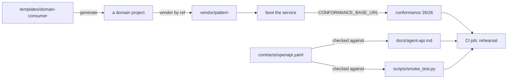

# Onboarding a domain can actually complete — design

**Method.** Claims below marked `VERIFIED` were produced by running the thing on `main` at
`b0fce54`, 2026-10-23, in this session. Nothing here is taken from documentation.

## Verified ground

| Assumption the design rests on | Result |
|---|---|
| `git archive <ref> patterns/<name>` reproduces the release tarball's tree | **VERIFIED** — identical, and `pattern.yaml` digests match byte for byte (`5e6b89e8…`) |
| `git archive` is in fact *cleaner* than the release `tar` | **VERIFIED** — the release step excludes only three cache directories, so it ships `.mypy_cache` and `.terraform` if the runner's tree has them. `git archive` takes only what is committed |
| `verify_pattern_lock.py` does not care how the pattern was vendored | **VERIFIED** — it compares `metadata.version` and the `pattern.yaml` digest against the vendored copy, nothing else. It needs no change |
| The conformance suite can run against a domain's own build | **VERIFIED** — 26/26 via `CONFORMANCE_BASE_URL`, 30 requests served; a dead port fails all 26 |
| The template's config cannot validate against the pattern schema | **VERIFIED** — five errors, including `rbac` and `privacy` rejected by `additionalProperties: false` |
| `smoke_test.py` fails against a correct build | **VERIFIED** — `SMOKE TEST FAILED — 3 checks` |

## Approach

The seven defects are symptoms. The cause is that **no mechanism executes the onboarding path**, so
every correction has the same half-life as the last one. The design therefore adds one executable
artifact and makes the documents derive from it or be checked against it.

**The rehearsal job is the deliverable.** It generates a domain project from the template, applies
a configuration, adds sample extensions, boots the service against the fake bank and runs the
conformance suite against it over HTTP. No cloud credentials, so it runs on every pull request. If
the template's configuration, entry point or smoke test is wrong, the job is red.

**Vendoring by ref (the approved decision).** `vendor_pattern.py` gains two sources besides a
release tag:

| `pattern.lock.yaml` says | Behaviour |
|---|---|
| `tag:` | Today's path — `gh release download`, verify against `SHA256SUMS` |
| `ref:` | `git archive` at that ref; the lock records the **resolved commit sha**, not the symbolic ref |
| `path:` | Copy from a local checkout. Refuses unless the lock also says `unreleased: true` |

A ref-vendored lock records the commit because two domains can otherwise both claim `0.1.0` from
different commits, and the manifest digest only catches drift *within* one project. The checksum
step is skipped for ref and path sources — there is no published `SHA256SUMS` — and the script says
so out loud rather than implying a verification it did not perform.

**Configuration path.** One change, not a documented discrepancy: `DEFAULT_CONFIG_PATH` becomes
`/app/config/domain-config.yaml`, matching what the guide and template tell a domain to create. The
Dockerfile already copies `config/` to `/app/config/`, so the container then finds it with no
`CONFIG_PATH` set and no Terraform change.

**The two documents that mislead** are brought under a check rather than rewritten and trusted.
`docs/agent-api.md` may name only operations present in `contracts/openapi.yaml`; `smoke_test.py`
must pass against the reference build. Both are asserted by the rehearsal job.

Generation was considered for `agent-api.md` and rejected for now: a generator is more machinery
than a check, and the check fails just as loudly. Recorded as an alternative, not a decision.

## Contract

**No change to the tool API, the error catalogue, the reason codes or `pattern.yaml`.** This work
touches onboarding materials, one default path, and CI.

Changed surfaces, all outside the tool API:

| Surface | Change | Breaks |
|---|---|---|
| `pattern.lock.yaml` | `ref:`, `path:`, `unreleased:` added; `tag:` unchanged | Nothing — existing locks keep working |
| `DEFAULT_CONFIG_PATH` | `domain.yaml` → `domain-config.yaml` | Anyone relying on the old default. Nobody does; the path has never worked end to end |
| `templates/domain-consumer/*` | Config, Dockerfile, smoke test, agent API doc corrected | A domain that already generated from the template. None exist |

**Deliberately not fixed here:** recall returns the fact text in `value` rather than the structured
value that was written. That is a contract change and needs its own feature. `OPEN`.

## Configuration and extension points

No new extension point, and no new configuration key in the pattern. The template's
`config/domain-config.yaml` is rewritten to the schema the pattern actually enforces — `domain`,
`topics`, `callers`, `identity`, `quota`, `observability`, with `retention` and `extensions`
optional — carrying neutral placeholders and a comment per required key.

The sample extensions the rehearsal uses ship under a name that cannot be mistaken for
production-ready, and their docstrings say plainly what they are. A domain replaces them; they
exist so the rehearsal exercises a *real* classifier path rather than the deny-all default.

## Security

| Rule | Touched? | Covered by |
|---|---|---|
| S-1 authentication | No change. The rehearsal runs with `ENVIRONMENT=local`, which the service already refuses outside a local environment | existing `test_auth.py` |
| S-2 deny by default | No change | existing `test_policy_pipeline.py` |
| S-3 classify before persisting | No change. Sample extensions are additive; the deny-all defaults stay the defaults | existing suite |
| S-4 nothing in logs | The rehearsal asserts no payload, value or raw subject reaches the service's output — the check I ran by hand becomes a job step | new rehearsal job |
| S-5 secrets by name | `.env.example` carries names and empty values only; the rehearsal supplies `SUBJECT_HMAC_KEY` from the environment | new check that `.env.example` holds no value |
| S-6 least privilege | No change. No Terraform is applied | existing boundary check |
| S-7 audit | No change | existing `test_verification.py` |
| S-8 no cross-domain reach | No change | existing suite |

One new risk the design introduces and must close: a `path:` vendor source could let a domain ship
a locally modified pattern while the lock still claims a version. Mitigated by requiring
`unreleased: true` alongside `path:`, and by `verify_pattern_lock.py` continuing to compare the
manifest digest — so a modified `pattern.yaml` fails regardless of source.

## Risks

| Risk | Compensation | Expiry |
|---|---|---|
| The rehearsal job runs against the **fake** bank, so it proves the documented path works, not that the provider does | Live verification stays separate (`spike/verify_live.py`, 19/19). The job's output must say which it ran | Re-check at each release |
| `ref:` vendoring makes it easy to adopt an unreleased pattern and stay there | The lock records `unreleased: true`; `pattern-release` reports any domain-visible path still unreleased. Revisit once v0.1.0 exists | v0.1.0 |
| Fixing seven documents may surface an eighth the rehearsal does not cover — operations and upgrade docs are not executable | Stated, not hidden. The runbook and upgrade guide stay review-only | — |
| Changing `DEFAULT_CONFIG_PATH` is a change to pattern source in a docs-focused feature | Single constant, covered by a test asserting the container-default path resolves the template's filename | — |

## Tasks

- [x] `vendor_pattern.py`: `ref:` and `path:` sources, resolved commit recorded, skipped checksum stated
- [x] Rewrite `templates/domain-consumer/config/domain-config.yaml` to the enforced schema
- [x] Rewrite `templates/domain-consumer/scripts/smoke_test.py` against the synchronous contract
- [x] Rewrite `templates/domain-consumer/docs/agent-api.md`; add the check against `contracts/openapi.yaml`
- [x] Fix the template `Dockerfile` entry point and the missing `uv.lock` assumption
- [x] `DEFAULT_CONFIG_PATH` → `domain-config.yaml`, with a test
- [x] Add `.env.example` with names and empty values, and a check that it carries no value
- [x] Sample extensions for the rehearsal, named so they cannot be mistaken for production code
- [x] The rehearsal CI job, including the S-4 log assertion
- [x] `docs/onboarding/domain-adoption.md`: real steps, real template, no `/domain-onboard`
- [x] `docs/onboarding/demo.md`: local-run section rewritten against the rehearsal

## Found while implementing

Three things the work surfaced that were not in the plan. The first two are fixed here; the third
is not, and must not be.

| Found | Treatment |
|---|---|
| `vendor_pattern.py` wrote the manifest digest unindented on its own line, because `\s*` crossed the newline when the key had no value yet — exactly how the template ships. The first vendoring a domain performed corrupted its own lock file | Fixed in task 1, with a test |
| The conformance suite cannot run from a runtime install: it needs an HTTP client from the `[dev]` extra, and nothing said so. "The step that matters" could not be run as documented | Fixed in task 9; both guides now say to install the extra |
| **`IDEMPOTENCY_KEY_REUSED` is declared and unimplemented.** It is in the error catalogue, in `contracts/openapi.yaml`, in the conformance suite's code list, and named in both guides as something a domain must not change — but raised nowhere in `src/`. The service checks the key is present and discards it, so replaying a key with a different body silently writes | **OPEN.** Not fixed here. It is pattern behaviour, not onboarding material, and carries a design question: an in-memory key store is per-instance, so with N instances idempotency would be unreliable in the same way the write budget was. Needs its own feature |

## Approval

Approved by Srinivasa reddy, 2026-10-23, instructed in session.
