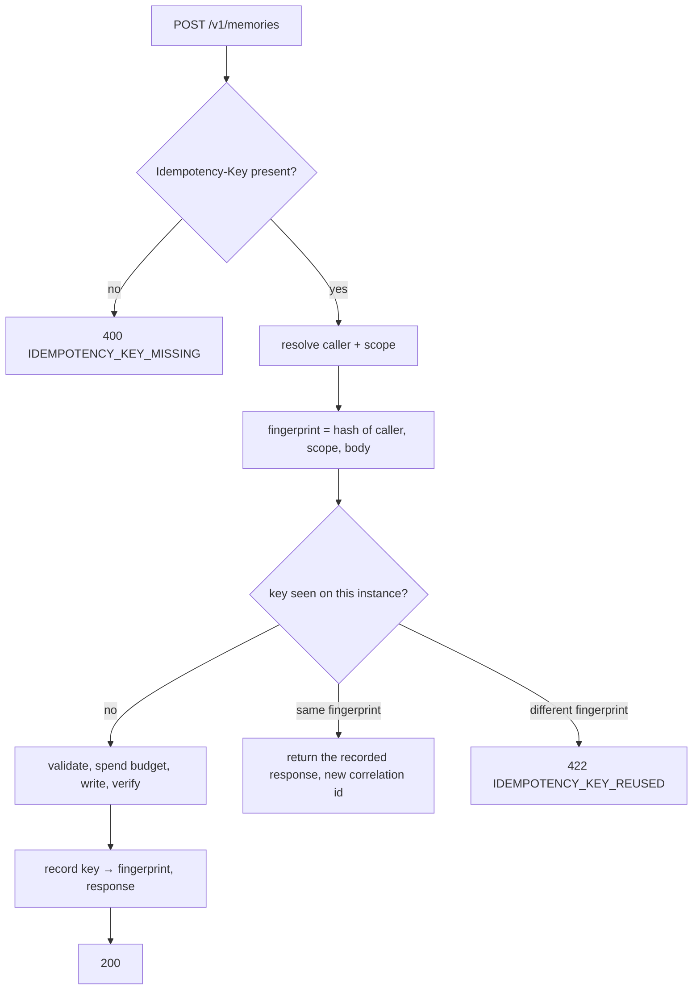

# The idempotency the contract already promises — design

**Method.** Everything marked `VERIFIED` was produced by reading or running the code on
`design/011-onboarding-that-works` at `bcb7681`, 2026-10-23, in this session.

## Verified ground

| Assumption | Result |
|---|---|
| A cached response holds no memory content | **VERIFIED** — `RememberResponse` carries `outcome`, `stored`, and per fact `index`, `topic`, `reasonCode`, `memoryId`. No value, no fact text. Caching it stores decisions and identifiers, which is what S-4 permits |
| The correlation id is **not** in the body | **VERIFIED** — it travels in the `X-Correlation-Id` header. A replay must therefore emit the *new* request's id, or two different requests share one id and tracing stops working |
| Two end users in one domain resolve to distinct scopes | **VERIFIED** — `user_id 4590da15…` vs `664c847e…`. A body-only fingerprint would hand one caller the other's response, carrying a `memoryId` from a scope they cannot read |
| Retryable failures are returned through `error_response` | **VERIFIED** — `RATE_LIMITED` and `PROVIDER_UNAVAILABLE` both. Caching either would make a transient outage permanent for that key |
| 001 named this control and accepted the residual | **VERIFIED** — "per-instance replay cache" is one of three compensations in 001's risk table, expiring 2027-04-22. Two of the three are in place |

## Approach

A bounded, expiring, per-instance record of what each idempotency key did, consulted after the
caller and scope are known and before anything is written.

**Where it sits.** After `_resolve`, because the fingerprint needs the caller and the scope; before
validation and before the budget is spent, because a replay must not consume quota it already
consumed. The key-present check stays where it is.

**What is recorded.** The fingerprint and the completed response. Only outcomes that *completed*:
`written`, `written_unverified`, `noop`. **Never a retryable failure.** Caching a
`PROVIDER_UNAVAILABLE` would turn a five-second outage into a permanent one for that key, and the
caller would be following the `Retry-After` we gave them into a wall.

**The key namespace is per caller and per scope** — entries are filed under a digest of the
caller, the scope and the key, and the fingerprint then identifies the body alone.

*Revised during implementation.* This section first said the fingerprint should cover caller,
scope and body, with entries filed under the raw key. Testing two end users sending the same key
with the same body showed that to be wrong: they got `422`, a refusal the contract does not
sanction, for a collision they can neither see nor fix. A global namespace fails both ways — the
second end user receives the first's response and a `memoryId` from a scope they cannot read, or
is refused for someone else's choice of string. Namespacing reaches the same guarantee properly.

**Correlation id.** The replay returns the recorded body with the *current* request's correlation
id. A replay is a distinct request and must be traceable as one.

**Bounding.** An LRU with a maximum entry count and a per-entry expiry. Both are needed: expiry
alone lets a flood of unique keys grow memory without limit before anything ages out, and a cap
alone lets a quiet instance hold a key long past any plausible retry.

## Contract

**No change.** This implements `contracts/openapi.yaml` as written:

> The same key with the same payload yields one effect and returns the original result; the same
> key with a different payload returns `422`.

`IDEMPOTENCY_KEY_REUSED` already exists in the catalogue at `422`, already appears in the
conformance suite's code list, and is already named in both onboarding guides. Nothing published
changes; something published starts being true.

The guarantee holds **within one instance**. Across instances it is best-effort, resting on
session affinity and provider consolidation. That limit is a residual risk with an expiry, not a
contract change — the decision taken on 2026-10-23.

## Configuration and extension points

No new extension point. Two values with defaults, so a domain that configures nothing still gets
the behaviour:

| Key | Default | Why |
|---|---|---|
| `idempotency.retentionSeconds` | 900 | Longer than any plausible client retry budget, short enough to bound memory |
| `idempotency.maxEntries` | 10000 | A hard ceiling independent of expiry |

Both optional and additive, so an existing domain configuration keeps validating.

## Security

| Rule | Touched | Covered by |
|---|---|---|
| S-1 authentication | No. The replay check runs **after** `_resolve`, so an unauthenticated request never reaches the cache | existing `test_auth.py` |
| S-2 deny by default | No new allow path. An unrecognised key falls through to the full pipeline | new tests |
| S-3 classify before persisting | No. A replay writes nothing, so nothing bypasses classification. A *changed* payload is refused, not reclassified | new test asserting the provider is not called on replay |
| S-4 nothing in logs | The cached value holds no fact text or value (`VERIFIED` above). The replay metric carries `decision="replayed"` — a code, not content | new test |
| S-5 secrets | Untouched | — |
| S-6 least privilege | Untouched. No new managed service, no IAM change | — |
| S-7 audit | A replay must emit its own audit event. A write that "already happened" is still a request someone made, and an audit trail that silently omits replays cannot answer "who asked for this" | new test |
| **S-8 no cross-domain reach** | **Touched.** The cache is keyed per instance and shared across callers, so the fingerprint must include caller and scope or it becomes a cross-scope read | new test: two subjects, same key, neither sees the other's response |

S-8 is the one to review closely. A replay cache done carelessly is a mechanism for handing one
end user another's `memoryId`.

## Risks

| Risk | Compensation | Expiry |
|---|---|---|
| **Cross-instance replay still writes twice.** The accepted residual, now with two of three compensations in place and the third built | Session affinity; provider consolidation dedups identical facts (verified live). Documented in `agent-api.md` as a within-instance guarantee | 2027-04-22, inherited from 001 |
| A client could read the cache as durable and stop sending fresh keys | The guarantee is documented as best-effort across instances, and the cache is explicitly not a store of record | — |
| Memory growth under a flood of unique keys | Hard entry cap plus expiry, and a test that drives more keys than the cap and asserts the bound holds | — |
| Caching a response makes a later policy change invisible for its lifetime — a fact refused after a tightening still replays its old `ACCEPTED` | Bounded by `retentionSeconds`. Worth stating in the guide rather than hiding | — |

## Tasks

- [x] `ReplayCache`: bounded, expiring, thread-safe; namespaced per caller and scope
- [x] Wire into `remember` after `_resolve`, before validation and the budget
- [x] Record only completed outcomes; never a retryable failure
- [x] Replay emits the current correlation id and `decision="replayed"`
- [ ] Replay emits its own audit event — **blocked**, see below
- [x] `idempotency.retentionSeconds` and `maxEntries` in the config schema, with defaults
- [x] Unit tests, including the S-8 two-subject case and the memory bound
- [x] Conformance coverage for both halves of the promise
- [x] `errors.md`: state the guarantee and its within-instance limit
- [x] `agent-api.md`: the same, done after #11 merged — this branch predated its rewrite there
- [x] Record the residual in 001's risk table as compensated, not merely accepted

## Approval

Approved by Srinivasa reddy, 2026-10-23, instructed in session.

## Blocked, and why

**The replay audit event cannot be written yet: the API layer has no audit sink.** Checking before
implementing it, rather than inventing one:

`pattern.yaml` declares seven required audit events — `memory_write`, `memory_deletion`,
`policy_denial`, `configuration_change`, `role_grant`, `role_revocation`, `exception_invoked`.
**None of the seven is emitted anywhere in `src/`.** Two events that are not declared
(`memory_remediation`, `memory_write_unverified`) are emitted, from `verify_write`, which is the
only component that takes an `AuditSink` at all. `Deployment` has no audit sink, so the `remember`
path emits nothing — including for a write, which security rule S-7 requires.

This is the same defect shape as the metrics gap found in 011: declared in the manifest, absent
from the code, and invisible because nothing compared the two.

Adding a sink to the API layer to emit one replay event would be implementing S-7 on the write
path inside a feature about idempotency, and would leave the other six still missing. It needs
its own feature, and that feature should include the manifest-versus-code check that would have
caught this, as `tests/test_observability.py` now does for metrics.

Recorded as `OPEN`, 2026-10-23.