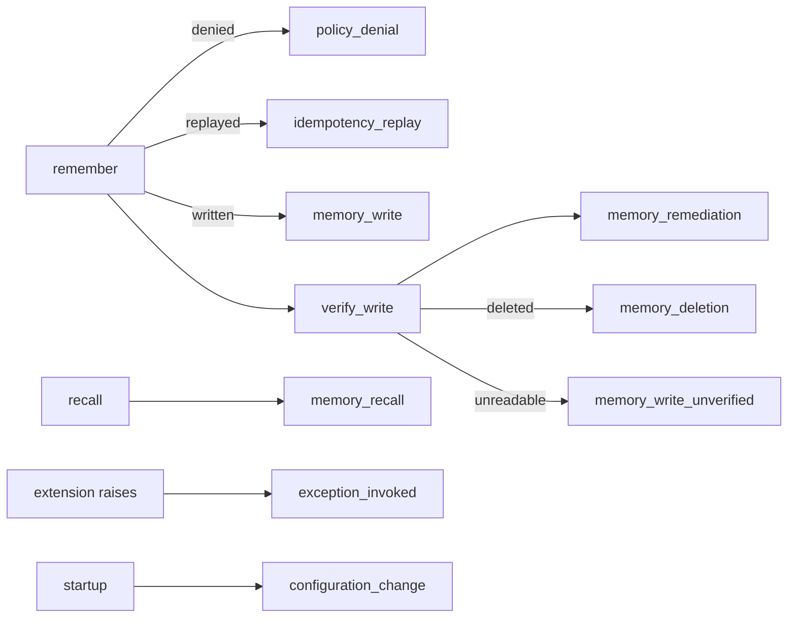

# Audit events that actually exist

## Approach

One module owns the list, exactly as `observability/metrics.py` owns `METRICS`. A new
`observability/audit.py` declares `AUDIT_EVENTS`, the `AuditSink` protocol, a `NullAudit` and a
`LoggingAudit` that refuses an undeclared event and a field that would carry payload. A test
compares `AUDIT_EVENTS` against `pattern.yaml` in both directions, and compares it against what
the source actually emits in both directions. That pairing is what stops the manifest and the
code drifting apart again; it is the fix that worked for metrics in 011, applied to the same
class of defect.

`AuditSink` currently lives in `worker/verification.py` and is the only one in the codebase.
It moves to `observability/audit.py` and `verification.py` imports it from there, so there is one
definition rather than two.

`Deployment` gains an `audit: AuditSink` field defaulting to `NullAudit`, wired by `bootstrap` to
a `LoggingAudit` carrying the domain. `verify_write` is then called **with** that sink, which is
what makes its two existing events reach a real deployment for the first time.

`VERIFIED` 2026-10-24: `verify_write` is called from `api/main.py` with no `audit=` argument, so
`log` falls back to `_Null()`. Both `memory_remediation` and `memory_write_unverified` are
discarded in every deployment that exists today, not merely undeclared.

### The event set

Nine events, chosen as what this component can actually attest to.

| Event | Emitted where | Carries |
|---|---|---|
| `memory_write` | `remember`, after verification | correlation id, caller, domain, scope owner's pseudonym, count, outcome |
| `memory_recall` | `recall`, after serving | correlation id, caller, domain, pseudonym, served and withheld counts |
| `policy_denial` | `remember`, per refused request; also a caller refused an operation | correlation id, caller, domain, reason code |
| `memory_deletion` | remediation that deleted a memory | correlation id, caller, domain, reason |
| `memory_remediation` | remediation, any outcome | as today |
| `memory_write_unverified` | verification could not re-read a write | as today |
| `configuration_change` | startup | domain, topic and caller counts, extension names, config digest |
| `exception_invoked` | a domain extension raised | correlation id, caller, extension, error type |
| `idempotency_replay` | a replay returned a recorded response | correlation id, caller, domain |

`memory_recall` goes beyond what S-7 names. That is deliberate and was decided in the intent: a
read of someone's memory is what an investigator would want a trail of, and the volume cost is
accepted.

**`role_grant` and `role_revocation` are removed from the manifest.** The service never grants or
revokes a role — roles arrive in configuration and in IAM. Declaring them asserted a
responsibility it cannot discharge. The both-directions check would now fail if either were added
back without a call site, which is the point: the manifest can no longer promise what the code
does not do.

`configuration_change` is kept with one honest meaning: *started with this configuration*. The
service reads configuration at startup and never changes it at runtime, so there is no other
event to emit, and this is the one that tells an investigator which policy was in force.

## Contract

**No change to the API contract.** No endpoint, request shape, response shape, status code or
reason code changes. Audit emission is a side effect on paths that already exist; a caller cannot
observe it and cannot suppress it.

`pattern.yaml`'s `spec.observability.requiredAuditEvents` changes from seven entries to the nine
above. That is a manifest correction, not a contract break: nothing consumed the old list, because
nothing emitted it.

Also in this branch, as decided in the intent: `metadata.status` moves from `proposed` to `alpha`,
and `metadata.maintainer.contact` becomes a real neutral address.

## Configuration and extension points

**Nothing new to configure, by design.** A domain cannot turn audit off, choose which events it
emits, or redirect them — an audit trail a domain can disable is not an audit trail. There is no
schema change.

Emission is a structured log line on the `memory_manager.audit` logger, as metrics are, so Cloud
Logging's sink picks it up with no client in the service. Where the events land is
platform-owned Terraform and is out of scope.

## Security

| Rule | How this touches it | Test |
|---|---|---|
| **S-7** every write, denial and deletion emits an audit event with a correlation ID | the whole feature; every event carries `correlation_id` | `test_audit.py` asserts each path emits, and each emission carries a correlation id |
| **S-4** nothing prohibited in logs | audit records are a new place payload could leak | `LoggingAudit` rejects a prohibited field name and an over-long value; a test asserts against *emitted records*, not the source |
| **S-8** one domain cannot reach another's scope | audit identifies the scope owner | the pseudonym is emitted, never the raw subject; a test asserts the raw subject never appears |
| **S-1** fail closed | an audit sink that raises must not swallow a denial | emission is never in a `try` that would convert a refusal into a success; a test removes a call and asserts a specific failure |

The scope owner is identified by the HMAC pseudonym the service already derives. The raw subject
is never emitted, so an audit record cannot be reversed to an end user by anyone without the key.

## Risks

| Risk | Compensating control | Expiry |
|---|---|---|
| `memory_recall` roughly doubles audit volume on a read-heavy domain | records are small and fixed-shape; the decision to accept the cost is recorded in the intent | review when a domain reports a logging bill |
| A `LoggingAudit` that raises on a bad field would turn a successful write into a 500 | the rejections are programming errors, caught by tests at build time, not runtime conditions — the same bargain `LoggingMetrics` already makes | none |
| `configuration_change` carries a config digest; a digest of a file containing a secret would be a weak oracle | configuration carries no secret values — secrets are named and resolved from the environment, which the schema enforces | none |
| `AuditSink` moving out of `worker/verification.py` touches a module this feature otherwise would not | it is the same protocol, imported rather than redefined; no behaviour change, covered by the existing verification tests | none |
| The duplicated `MetricSink` in `worker/verification.py` stays duplicated | out of scope — reported, not fixed | next time that module is opened |

`OPEN`: whether an investigator actually wants `memory_remediation` and
`memory_write_unverified` in the shape they have. They are kept as they are and now declared; no
one has reviewed them against a real investigation.

## Tasks

- [ ] 1. `observability/audit.py`: `AUDIT_EVENTS`, `AuditSink`, `NullAudit`, `LoggingAudit`; export from `observability/__init__.py`
- [ ] 2. `worker/verification.py` imports `AuditSink` from observability rather than redefining it
- [ ] 3. `Deployment.audit`, wired in `bootstrap`; `verify_write` called with it
- [ ] 4. Emit `memory_write`, `policy_denial` and `idempotency_replay` on the remember path
- [ ] 5. Emit `memory_recall` on the recall path
- [ ] 6. Emit `memory_deletion` on a remediation delete
- [ ] 7. Emit `configuration_change` at startup and `exception_invoked` on an extension failure
- [ ] 8. `pattern.yaml`: the nine events; `status: alpha`; a real maintainer contact
- [ ] 9. `tests/test_audit.py`: both directions against the manifest, both directions against the source, S-4 against emitted records, and a negative test per emitting call
- [ ] 10. `make verify`, and break each guarantee to prove the test fails
